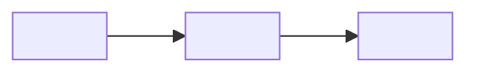

{/*
  TEMPLATE: Guide (one goal, start to finish, often across several features).
  A guide links to Documentation pages for field details. Never copy field tables into a guide.
  Delete every template comment before you commit. Keep SCREENSHOT comments.
  Rules: .mintlify/AGENTS.md. Run the asd-ste100 pass on prose when done.
*/}

Use this guide to <goal>. At the end, you have:

- <Concrete result 1>
- <Concrete result 2>

**Who this is for:** <role, e.g. editors and workspace admins who use the DXP dashboard>.

**Time:** <about N minutes>.

## Prerequisites

- <Access or role>
- <Feature turned on — link to its Availability section>
- <Anything to prepare first>

## How it works

{/* Optional mermaid flowchart of the stages. Delete if the guide is short. */}

## <Stage 1 title>

<Steps>
  <Step title="<Action>">
    <What to do and why. Link to the Documentation page for field details:
    refer to [<Feature>](/dxp/documentation/<path>#<anchor>).>
  </Step>
</Steps>

{/* SCREENSHOT: <feature>-<screen>.png | <route> → <clicks> | show: <state> */}

## <Stage 2 title>

## How you know it worked

- <Observable result in the dashboard or on the site>

## Next steps

- [<Related guide or page>](/dxp/documentation/<path>)
