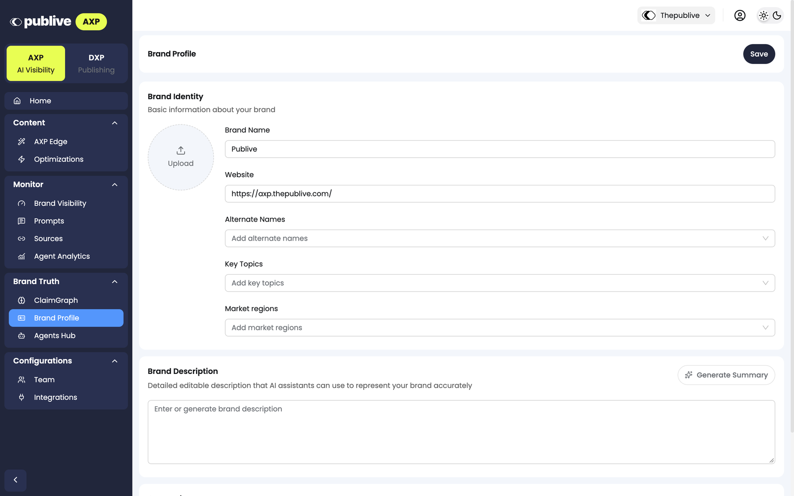
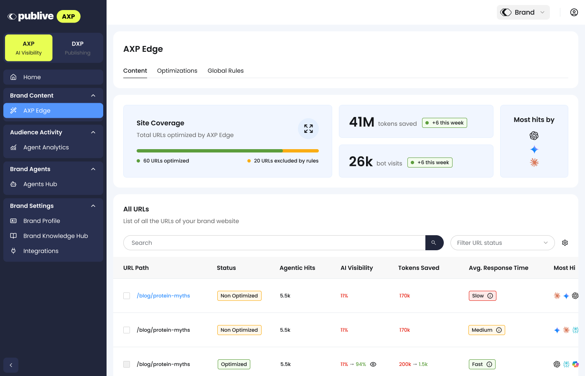
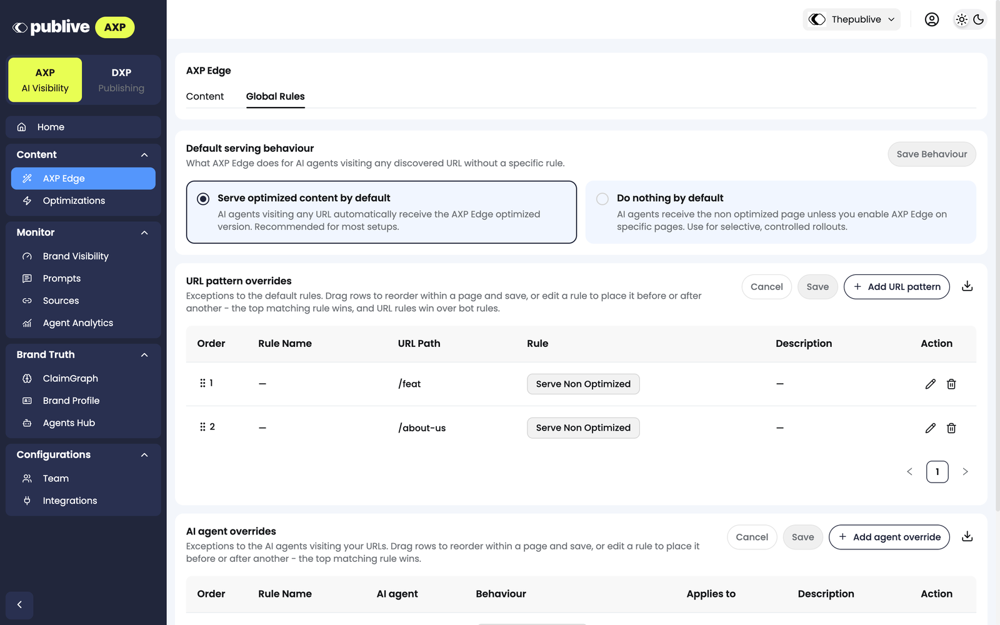

The AXP dashboard is where you use every Publive AXP product. It shows what AXP Edge does on your domain and what AI assistants say about your brand. You also use it to control which pages AXP Edge optimizes and what AI agents receive.

The sidebar has these groups:

| Group | Pages |
|---|---|
| **Content** | [**AXP Edge**](#axp-edge) and [**Optimizations**](/axp/axp-edge/optimizations) |
| **Monitor** | [**Brand Visibility**](/axp/monitor/brand-visibility), [**Prompts**](/axp/monitor/track-prompts), [**Sources**](/axp/monitor/sources), and [**Agent Analytics**](/axp/axp-edge/agent-analytics) |
| **Brand Truth** | [**Brand Profile**](#brand-profile) |
| **Configurations** | **Team** and [**Integrations**](#integrations) |

## Home

**Home** shows three cards and a list of quick actions.

| Card | What it shows |
|---|---|
| **Content Visibility** | How much of your content AI agents can read, as a percentage |
| **Pages Live at Edge** | The number of pages where AXP Edge serves optimized content to AI agents |
| **Agentic Interactions** | The number of times AI agents requested your pages |

The quick actions open the pages that you use most, for example **Review optimized pages** and **Edit Global Rules**.

## Brand Profile

**Brand Profile** is in the **Brand Truth** group. It holds the brand context that AXP uses to represent your site to AI agents. [Prompt monitoring](/axp/monitor/overview) also uses it to find your brand and your competitors in AI responses.

<Frame>
  
</Frame>

| Section | What it contains |
|---|---|
| **Brand Identity** | **Brand Name**, **Website**, **Alternate Names**, **Key Topics**, and **Market regions** |
| **Brand Description** | A description that AI assistants can use to represent your brand. Click **Generate Summary** to make a draft. |
| **Competitors** | The competitors that you track. Click **Add competitor** to add one. Refer to [Competitor profiles](#competitor-profiles). |

Click **Save** to save your changes.

### Competitor profiles

Each competitor has its own profile, with a status: suggested, accepted, or rejected.

- AXP shows the brands that it finds in AI responses as suggested competitors. Accept or reject each one.
- When you rename a brand, AXP keeps its history.
- A brand can have more than one domain.

[Brand AI Observability](/axp/monitor/overview) uses your accepted competitors for share of voice, the leaderboard, and head-to-head comparisons.

## AXP Edge

The **AXP Edge** page is in the **Content** group. It has two tabs: **Content** and **Global Rules**.

### Content

The **Content** tab shows which URLs on your domain AXP Edge optimizes.

<Frame>
  
</Frame>

- **Site Coverage:** The number of URLs that AXP Edge optimizes, and the number of URLs that rules exclude.
- **Most Agentic Hits by:** The AI agents that visit your pages most, and the total number of AI agent visits.
- **All URLs:** Each URL on your domain that AXP Edge found. Click **Filter** to filter the list.

| Column | What it shows |
|---|---|
| **URL Path** | The path of the page |
| **Status** | **Optimized** if AXP Edge serves an optimized version of the page to AI agents |
| **Agentic Hits** | The number of AI agent requests for the page |
| **Content Visibility** | How much of the page content AI agents can read, as a percentage |
| **Tokens to Read** | The number of tokens that an AI agent reads on the page |
| **Average TTFB** | How fast the page starts to respond to AI agents (time to first byte), for example **Fast** |
| **Most Hits By** | The AI agents that request the page most |
| **Last Optimized At** | The date and time that AXP Edge last optimized the page |

When you optimize one page from the dashboard, AXP Edge renders the page immediately and its **Status** changes to **Optimized**. You do not wait for the next optimization cycle.

The **Actions** column has three icons:

- **Copy URL:** Copy the URL of the page.
- **View before/after AI visibility:** Compare what AI agents read before and after AXP Edge optimized the page.
- **Exclude** (a circle with a line): Open the **Add URL Pattern** dialog with the path of the page filled in. Refer to [URL pattern overrides](#url-pattern-overrides).

The row menu also has **Suggest prompts for this URL**. Refer to [Suggest prompts for a page](/axp/monitor/suggested-prompts#suggest-prompts-for-a-page).

### Global Rules

The **Global Rules** tab sets what AXP Edge serves to AI agents.

<Frame>
  
</Frame>

**Default serving behaviour** applies to every URL that has no specific rule.

| Option | What AI agents receive |
|---|---|
| **Serve optimized content by default** | The optimized version of every page. Publive recommends this option for most setups. |
| **Do nothing by default** | The page without optimization, unless you turn on AXP Edge for specific pages. Use this option for a selective rollout. |

To change the default, select an option. Then click **Save Behaviour**.

#### URL pattern overrides

A URL pattern override is an exception to the default behaviour for one page or section. Use it to:

- Exclude pages that AI agents must not get in optimized form. AI agents then get your normal origin page for those paths.
- Compare optimized and unoptimized pages on your own domain.
- Turn on AXP Edge for one section first, when the default is **Do nothing by default**.

<Steps>
  <Step title="Open the dialog">
    Click **Add URL pattern**. The **Add URL Pattern** dialog opens.
  </Step>
  <Step title="Name the rule">
    In **Rule name**, enter a name, for example `Block blog for AI`.
  </Step>
  <Step title="Enter the pattern">
    In **URL Pattern**, enter a relative path, for example `/about-us`. Use `*` as a wildcard, not regex. Refer to [URL pattern syntax](#url-pattern-syntax).
  </Step>
  <Step title="Select the AI agents">
    In **AI agent(s)**, select the AI agents that the rule applies to. The default is **All AI agents**.
  </Step>
  <Step title="Select the rule">
    In **Rule**, select what the AI agents receive, for example **Serve Non Optimized**. Optional: enter a **Description**.
  </Step>
  <Step title="Save the rule">
    Click **Save**.
  </Step>
</Steps>

#### URL pattern syntax

URL patterns are not regular expressions. A pattern matches the page path exactly. The only special character is `*`, which matches any text.

| Pattern | What it matches |
|---|---|
| `/regulatory/terms-and-conditions` | Only that page |
| `/blog/*` | Every page under `/blog/` |
| `*/amp` | Every URL that ends in `/amp` |

When you write a pattern:

1. Start the pattern with `/`.
2. Enter only the path. Do not include the domain or a query string, for example `?utm_source=…`.
3. Use `*` for "any text". Do not use regex.

<Warning>
  A pattern that uses regex syntax or a full URL never matches a page. AXP Edge then continues to apply the default behaviour to that page.
</Warning>

| Do not enter | Enter this |
|---|---|
| `^/regulatory/terms-and-conditions$` | `/regulatory/terms-and-conditions` |
| `/blog/.*` | `/blog/*` |
| `https://example.com/blog` | `/blog` |

If an exclude rule does not work, the page **Status** on the **Content** tab stays **Optimized**, and **Site Coverage** shows 0 excluded URLs. Examine the pattern for `^`, `$`, `.*`, or a domain, and remove them.

#### AI agent overrides

An AI agent override is an exception for specific AI agents. Click **Add agent override** to add one. The table shows the **AI agent**, the **Behaviour**, and the pages that the override **Applies to**.

#### Rule order

When more than one rule matches a request, the top matching rule wins. A URL rule wins over an AI agent rule.

To change the order, drag a row to a new position. Then click **Save**. You can also edit a rule to place it before or after a different rule.

## Optimizations

**Optimizations** sets the changes that AXP Edge makes to your pages for AI agents. For more information, refer to [Optimizations](/axp/axp-edge/optimizations).

## Agent Analytics

**Agent Analytics** shows how AI agents visit your pages. It is in the **Monitor** group. For more information, refer to [Agent Analytics](/axp/axp-edge/agent-analytics).

## Integrations

**Integrations** is in the **Configurations** group. It shows a card for each service that you can connect to AXP, for example **AXP Edge**, **Google Search Console**, and **Google Analytics 4**. The chip on each card shows its status, for example **Connected** or **Not connected**.

### Pause content optimization

The **Content Optimization** switch on the **AXP Edge** card turns optimization on or off for all pages.

- **On:** AI agents get your optimized pages. Human visitors get your normal site.
- **Off:** AXP pauses optimization. AI agents get your standard pages without optimization.

When you pause optimization, AXP keeps your URLs, statistics, and rules. AXP does not delete anything.

To pause optimization:

1. Go to **Configurations** > **Integrations**.
2. On the **AXP Edge** card, turn off the **Content Optimization** switch.
3. In **Pause content optimization?**, click **Pause**.

AI agents get your standard pages immediately. The status on the **AXP Edge** card changes to **Paused**.

To resume, turn on the switch again, and confirm in **Resume content optimization?**.

<Tip>
To stop optimization for some pages or AI agents only, use [Global Rules](#global-rules) instead.
</Tip>

### Crawl settings

{/* TODO(label): no Figma design for this screen. Add its location in the dashboard, the field names, and the option labels. Values below come from the edge-configuration API contract. */}

Crawl settings control how AXP Edge gets your pages. Changes apply immediately.

**Rendering mode** sets how AXP Edge loads a page:

| Mode | How AXP Edge loads the page | Use it when |
|---|---|---|
| Browser rendered | Opens the page in a browser and runs its JavaScript | Your site uses JavaScript to show its content |
| cURL | Gets the HTML that your server sends, without JavaScript | Your server sends the full content in the HTML |

**Frequency** sets how often AXP Edge gets your pages again to refresh the optimized version. The options are 30 minutes, 1, 2, 3, 4, 6, or 12 hours, 1 or 3 days, and 1, 2, or 4 weeks.

## Next steps

<CardGroup cols={2}>
  <Card title="Optimizations" icon="wand-magic-sparkles" href="/axp/axp-edge/optimizations">
    Turn on optimizations and review the additions that AXP suggests.
  </Card>
  <Card title="AXP Edge FAQ" icon="circle-question" href="https://axp.thepublive.com/faq">
    Common questions about setup, SEO impact, and failure behaviour.
  </Card>
</CardGroup>
