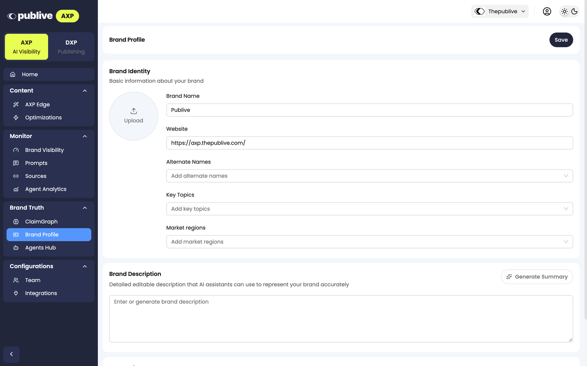
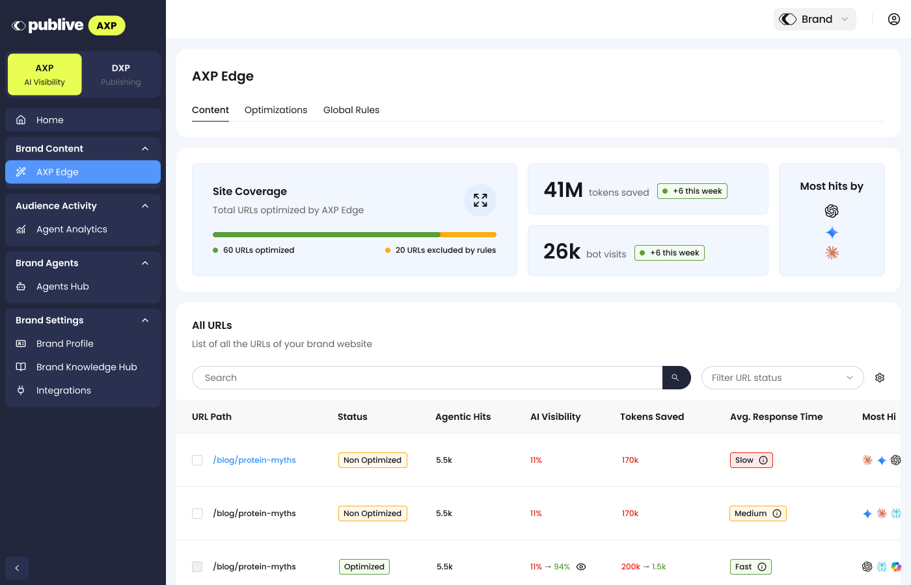
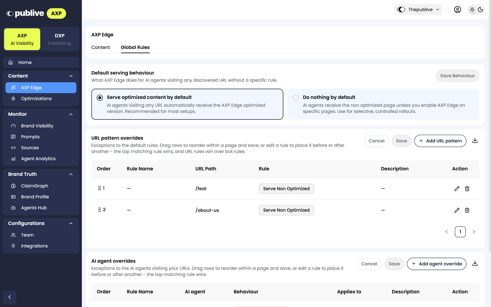

The AXP dashboard shows what AXP Edge does on your domain. You also use it to control which pages AXP Edge optimizes and what AI agents receive.

The sidebar has these groups:

| Group | Pages |
|---|---|
| **Content** | [**AXP Edge**](#axp-edge) and [**Optimizations**](/axp/axp-edge/optimizations) |
| **Monitor** | [**Brand Visibility**](/axp/monitor/brand-visibility), [**Prompts**](/axp/monitor/track-prompts), [**Sources**](/axp/monitor/sources), and [**Agent Analytics**](/axp/monitor/agent-analytics) |
| **Brand Truth** | [**Brand Profile**](#brand-profile) |
| **Configurations** | **Team** and **Integrations** |

## Home

**Home** shows three cards and a list of quick actions.

| Card | What it shows |
|---|---|
| **Content Visibility** | How much of your content AI agents can read, as a percentage |
| **Pages Live at Edge** | The number of pages where AXP Edge serves optimized content to AI agents |
| **Agentic Interactions** | The number of times AI agents requested your pages |

The quick actions open the pages that you use most, for example **Review optimized pages** and **Edit Global Rules**.

## Brand Profile

**Brand Profile** is in the **Brand Truth** group. It holds the brand context that AXP uses to represent your site to AI agents. [Prompt monitoring](/axp/monitor/overview) also uses it to find your brand and your competitors in AI responses.

<Frame>
  
</Frame>

| Section | What it contains |
|---|---|
| **Brand Identity** | **Brand Name**, **Website**, **Alternate Names**, **Key Topics**, and **Market regions** |
| **Brand Description** | A description that AI assistants can use to represent your brand. Click **Generate Summary** to make a draft. |
| **Competitors** | The competitors that you track. Click **Add competitor** to add one. |

Click **Save** to save your changes.

## AXP Edge

The **AXP Edge** page is in the **Content** group. It has two tabs: **Content** and **Global Rules**.

### Content

The **Content** tab shows which URLs on your domain AXP Edge optimizes.

<Frame>
  
</Frame>

- **Site Coverage:** The number of URLs that AXP Edge optimizes, and the number of URLs that rules exclude.
- **Most Agentic Hits by:** The AI agents that visit your pages most, and the total number of AI agent visits.
- **All URLs:** Each URL on your domain that AXP Edge found. Click **Filter** to filter the list.

| Column | What it shows |
|---|---|
| **URL Path** | The path of the page |
| **Status** | **Optimized** if AXP Edge serves an optimized version of the page to AI agents |
| **Agentic Hits** | The number of AI agent requests for the page |
| **Content Visibility** | How much of the page content AI agents can read, as a percentage |
| **Tokens to Read** | The number of tokens that an AI agent reads on the page |
| **Average TTFB** | How fast the page starts to respond to AI agents (time to first byte), for example **Fast** |
| **Most Hits By** | The AI agents that request the page most |
| **Last Optimized At** | The date and time that AXP Edge last optimized the page |

The **Actions** column has three icons:

- **Copy URL:** Copy the URL of the page.
- **View before/after AI visibility:** Compare what AI agents read before and after AXP Edge optimized the page.
- **Exclude** (a circle with a line): Open the **Add URL Pattern** dialog with the path of the page filled in. Refer to [URL pattern overrides](#url-pattern-overrides).

### Global Rules

The **Global Rules** tab sets what AXP Edge serves to AI agents.

<Frame>
  
</Frame>

**Default serving behaviour** applies to every URL that has no specific rule.

| Option | What AI agents receive |
|---|---|
| **Serve optimized content by default** | The optimized version of every page. Publive recommends this option for most setups. |
| **Do nothing by default** | The page without optimization, unless you turn on AXP Edge for specific pages. Use this option for a selective rollout. |

To change the default, select an option. Then click **Save Behaviour**.

#### URL pattern overrides

A URL pattern override is an exception to the default behaviour for one page or section. For example, use it to exclude a page from optimization.

<Steps>
  <Step title="Open the dialog">
    Click **Add URL pattern**. The **Add URL Pattern** dialog opens.
  </Step>
  <Step title="Name the rule">
    In **Rule name**, enter a name, for example `Block blog for AI`.
  </Step>
  <Step title="Enter the pattern">
    In **URL Pattern**, enter a relative path, for example `/about-us`.
  </Step>
  <Step title="Select the AI agents">
    In **AI agent(s)**, select the AI agents that the rule applies to. The default is **All AI agents**.
  </Step>
  <Step title="Select the rule">
    In **Rule**, select what the AI agents receive, for example **Serve Non Optimized**. Optional: enter a **Description**.
  </Step>
  <Step title="Save the rule">
    Click **Save**.
  </Step>
</Steps>

#### AI agent overrides

An AI agent override is an exception for specific AI agents. Click **Add agent override** to add one. The table shows the **AI agent**, the **Behaviour**, and the pages that the override **Applies to**.

#### Rule order

When more than one rule matches a request, the top matching rule wins. A URL rule wins over an AI agent rule.

To change the order, drag a row to a new position. Then click **Save**. You can also edit a rule to place it before or after a different rule.

## Optimizations

**Optimizations** sets the changes that AXP Edge makes to your pages for AI agents. For more information, refer to [Optimizations](/axp/axp-edge/optimizations).

## Agent Analytics

**Agent Analytics** shows how AI agents visit your pages. It is in the **Monitor** group. For more information, refer to [Agent Analytics](/axp/monitor/agent-analytics).

## Next steps

<CardGroup cols={2}>
  <Card title="Optimizations" icon="wand-magic-sparkles" href="/axp/axp-edge/optimizations">
    Turn on optimizations and review the additions that AXP suggests.
  </Card>
  <Card title="AXP Edge FAQ" icon="circle-question" href="https://axp.thepublive.com/faq">
    Common questions about setup, SEO impact, and failure behavior.
  </Card>
</CardGroup>
