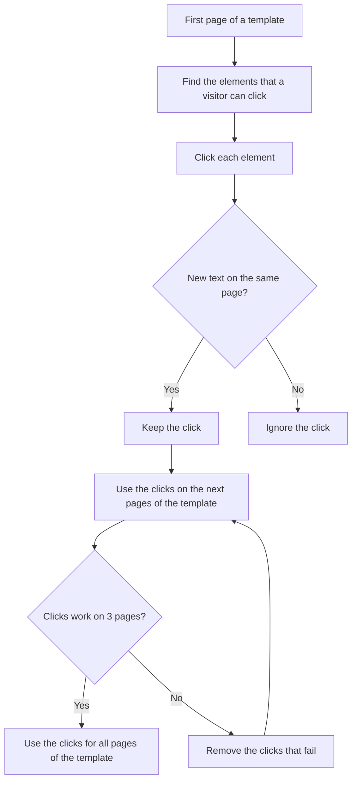
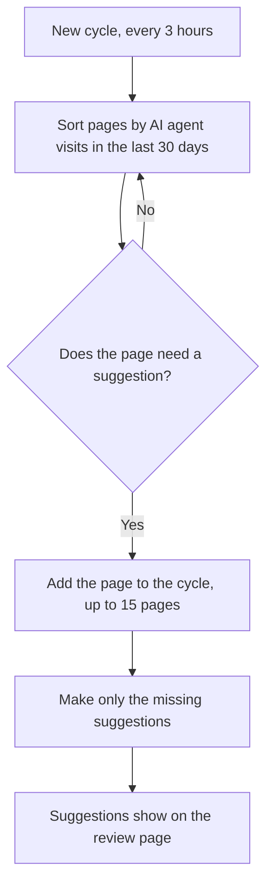

**Optimizations** sets how AXP Edge changes your pages for AI agents. It is in the **Content** group of the AXP dashboard sidebar. Human visitors and search crawlers always get your page without these changes.

The page has two sections:

- **Baseline optimizations** apply to every page that AXP Edge optimizes.
- **Page enhancements** add content to specific pages. You review each addition before AI agents get it.

You can also give specific AI agents different settings. Refer to [Set optimizations for specific AI agents](#set-optimizations-for-specific-ai-agents).

## Baseline optimizations

Click a group to see its optimizations. Use the switch next to an optimization to turn it on or off.

| Group | Optimization | What it does |
|---|---|---|
| **Cleanup** | **Strip noise** | Removes scripts, styles, comments, and attributes that are not content. AI agents read your content, not the parts of the site around it. |
| **Data structuring** | **Structure meta tags & JSON-LD** | Rebuilds a clean head with the meta tags and structured data of the page. This includes JSON-LD that the page puts in the body. |

**Heading Hierarchy Repair** is a baseline optimization that is off by default. It repairs the heading structure that AI agents get, for example a missing or duplicate H1, or a skipped heading level. The heading text and anchor links do not change. AXP Edge repairs the headings before it makes the table of contents, so the table of contents uses the repaired headings. To turn it on, use its switch.

## Page enhancements

{/* TODO(label): Figma (31 Aug 2026) puts the JSON-LD card under "Technical optimizations" with the title "Data Structuring", and the hidden-content card with the title "Interaction-Hidden Content". Confirm these labels in production. */}

Each card under **Content optimizations** and **Technical optimizations** is one type of addition. The card shows the number of pages that have a suggestion ready.

| Optimization | What AI agents get |
|---|---|
| **Add Table of Contents** | A linked table of contents above the page content. AXP makes it from the headings of the page. |
| **Add Relevant FAQs** | Some question-and-answer pairs from the page, below the page content, with matching `FAQPage` structured data |
| **Add LLM-Friendly Summaries** | A short summary in plain language at the top of the main content of the page |
| **Data Structuring** | JSON-LD structured data for the page, for example `Article`, `Product`, `HowTo`, or `Organization` |
| **Interaction-Hidden Content** | The text that the page shows only after a click, for example FAQ answers, tabs, drawers, and **Read more** sections |

AXP makes each addition from the text of the page only:

- For FAQs, AXP keeps only the answers that the page text supports word for word.
- For summaries, AXP keeps only the statements that come from the page.
- For JSON-LD, AXP uses only the facts that are on the page.
- For hidden content, AXP uses only the text that the page shows after a click.

Use the switch on a card to turn the optimization on or off. Click **Review** to see its suggestions.

<Note>
AI agents get an addition only after you apply it. Human visitors never see it.
</Note>

### Interaction-Hidden Content

AI agents read a page as it is after it loads. They do not click buttons. Text that shows only after a click is not in the page that they read. **Interaction-Hidden Content** finds this text and adds it to the page that AI agents get. Human visitors see the same text when they click.

**Interaction-Hidden Content** is off by default. To turn it on, use the switch on its card.

AXP gets the hidden text from these elements:

- Accordions, for example FAQ answers
- Drawers and pop-ups
- Tabs
- **Read more** buttons
- Carousel slides that load later

AXP does not get the text from:

- Content behind a paywall
- Lists that load more items each time you click or scroll
- Iframes and shadow DOM

#### How AXP finds the hidden text

You do not set up the clicks. AXP finds them automatically for each page template, for example all your product pages.

1. On the first page of a template, AXP finds the elements that a visitor can click.
2. AXP clicks each element and keeps only the clicks that show new text on the same page.
3. AXP uses these clicks again on the other pages of the template. After the clicks work on 3 pages, AXP uses them for all pages of that template.
4. If the layout of the template changes, AXP finds the clicks again.

The first pages of a template take longer than the pages after them.

#### Where AXP adds the text

| Element | Where AI agents get the text |
|---|---|
| Accordion or drawer | Immediately after the button that opens it |
| **Read more** | In place of the short text, as the full text |
| Other elements | In one section at the end of the page body |

AXP does not add text that is already on the page.

#### Safety

- AXP clicks only to show content. During its clicks, AXP blocks form submissions, data requests, links, and new windows.
- While AXP finds the clicks for a new template, your analytics tool can record some of these clicks.
- AXP uses an AI model to identify the elements that it can click. The model gets only the labels of buttons. It never gets the text of your page.

## How AXP picks pages for suggestions

AXP does not make suggestions for all your pages at the same time. It makes them in cycles, and it starts with the pages that AI agents visit most.

1. Every 3 hours, AXP sorts your pages by the number of AI agent visits in the last 30 days. Pages with no visits come last.
2. AXP goes down the list and finds up to 15 pages that need a suggestion. A page needs a suggestion when a page enhancement that is on has no result for that page yet.
3. For each of these pages, AXP makes only the suggestions that are missing. It does not make a suggestion again for an enhancement that already has a result.

### When AXP tries again

| Event | What AXP does |
|---|---|
| A suggestion fails, for example because of a timeout | AXP tries again in a later cycle. After 2 failed attempts, AXP stops until the page content changes. |
| AXP finds nothing to add, for example no questions for an FAQ | AXP records the result as complete and shows no suggestion. AXP does not try again until the page content changes. |
| The page content changes | AXP makes all the suggestions for the page again. The old suggestion moves to **Deprecated**. |
| You turn on a page enhancement | AXP also makes this suggestion for pages that already have results for other enhancements. It makes only the suggestion for the enhancement that you turned on. |

### Suggestion limit

Each page enhancement has a maximum of 15 suggestions at one time. When you review these 15 suggestions, AXP makes the next 15.

<Tip>
To get new suggestions sooner, apply or ignore the suggestions on the **Current suggestions** tab.
</Tip>

A page with few AI agent visits can wait for some cycles before it gets a suggestion. AXP gets to it after the busier pages.

## Review suggestions

The review page of an optimization has these tabs:

| Tab | What it shows |
|---|---|
| **Current suggestions** | The suggestions that are ready for your review |
| **Fixed suggestions** | The suggestions that you applied |
| **Ignored suggestions** | The suggestions that you ignored. You can still apply them. |
| **Deprecated** | Older suggestions that AXP replaced, with the date. When AXP makes a new suggestion for a page, the old suggestion moves to this tab. |
| **Overview & Guidance** | What the optimization changes, how it works, and which pages to approve first |

Each row shows the **URL Path** of the page and the date in **Suggested at**. To find a page, use **Search for URLs**. To select the columns that the table shows, click **Customise columns**.

To review a suggestion:

1. On the **Current suggestions** tab, click the expand icon on the row. The start of the suggestion shows with the label **AI Generated**.
2. Click **Preview** to see the full suggestion.
3. Click **Apply** to serve the addition to AI agents, or click **Ignore** to move the suggestion to **Ignored suggestions**.

### Which pages to approve first

| Optimization | Start with |
|---|---|
| **Add Table of Contents** | Long pages. Short pages get little value from a table of contents. |
| **Add Relevant FAQs** | How-to pages and pages that explain a subject. These pages answer the most questions. |
| **Add LLM-Friendly Summaries** | The pages that get the most traffic |
| **Interaction-Hidden Content** | Pages that keep important text in tabs, accordions, or drawers, for example FAQ pages and policy pages |

## Set optimizations for specific AI agents

{/* TODO(label): no Figma design for this screen. Add the location in the dashboard, the button and field labels, and the steps to add, edit, reorder, and delete an override. */}

By default, all AI agents get the same optimizations. To give some AI agents different settings, add an override for them.

- **Default settings** apply to all AI agents that no override matches.
- **An override** applies to one or more AI agents that you select, for example ChatGPT and Claude. It contains only the settings that you change. All other settings come from the default settings.

For example, an override for ChatGPT can turn on **Heading Hierarchy Repair**, which is off in the default settings. ChatGPT then gets pages with repaired headings. All other optimizations for ChatGPT stay the same as the default settings.

An override can also stop all optimization for its AI agents. These AI agents then get your pages without changes.

Each override has a name and an optional note. Two overrides cannot have the same set of AI agents.

### Override order

AXP Edge examines the overrides in order, from the top. The first override that includes the AI agent applies. Put specific overrides above general ones.

### When changes apply

AI agents get the new settings the next time AXP Edge renders the page. A page that AXP Edge rendered before the change keeps the old version until AXP Edge renders it again.

<Note>
Optimization overrides set what the optimized page contains. [Global Rules](/axp/axp-edge/dashboard#global-rules) set whether an AI agent gets the optimized page at all. If a Global Rule sends an AI agent the page without optimization, the optimization overrides for that AI agent have no effect.
</Note>

## Next steps

<CardGroup cols={2}>
  <Card title="AXP Edge dashboard" icon="gauge" href="/axp/axp-edge/dashboard">
    See which pages AXP Edge optimizes, and set rules for AI agents.
  </Card>
  <Card title="Agent Analytics" icon="chart-line" href="/axp/axp-edge/agent-analytics">
    See how AI agents visit your pages.
  </Card>
  <Card title="Guide: close citation gaps" icon="route" href="/axp/guides/close-citation-gaps">
    Find the pages that AI cites, and improve your own pages.
  </Card>
</CardGroup>
