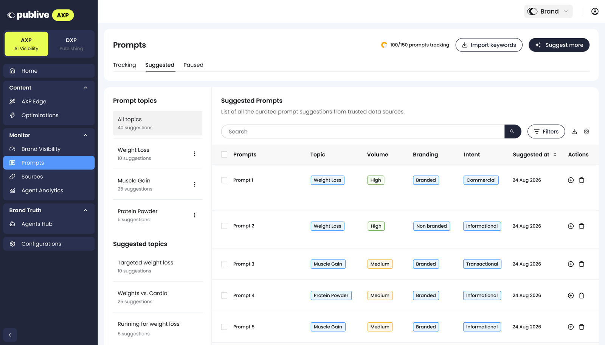
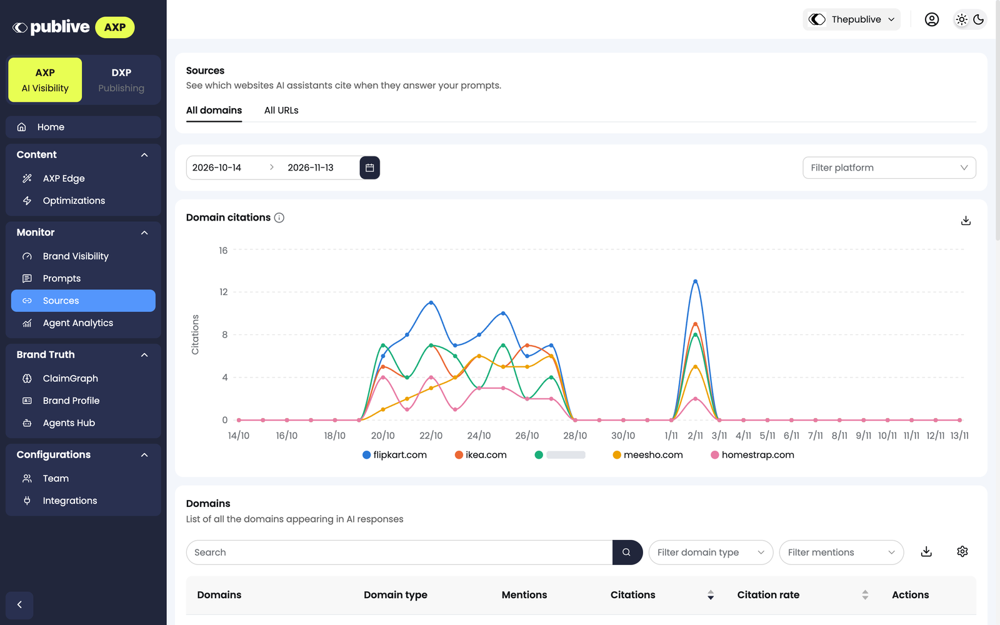
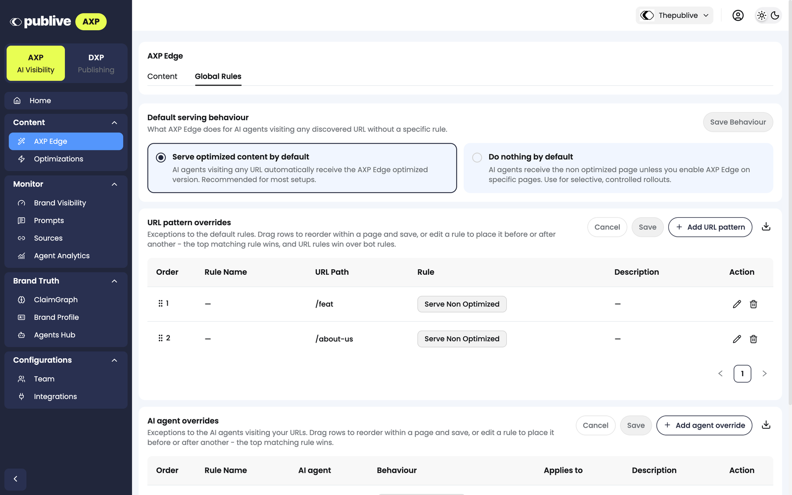
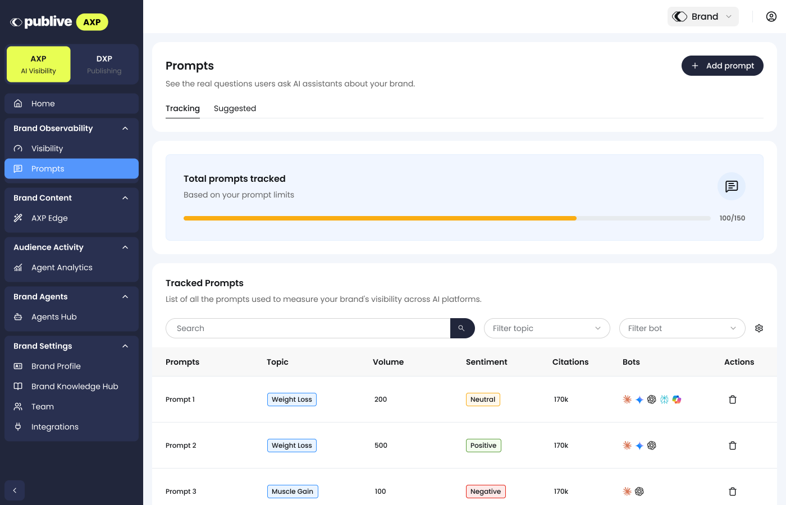
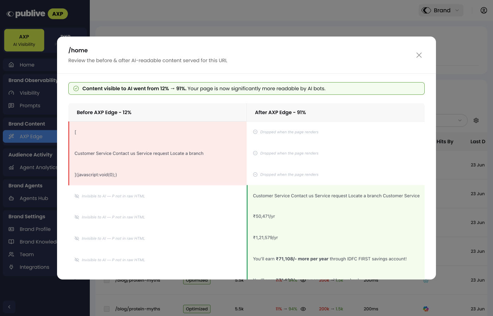
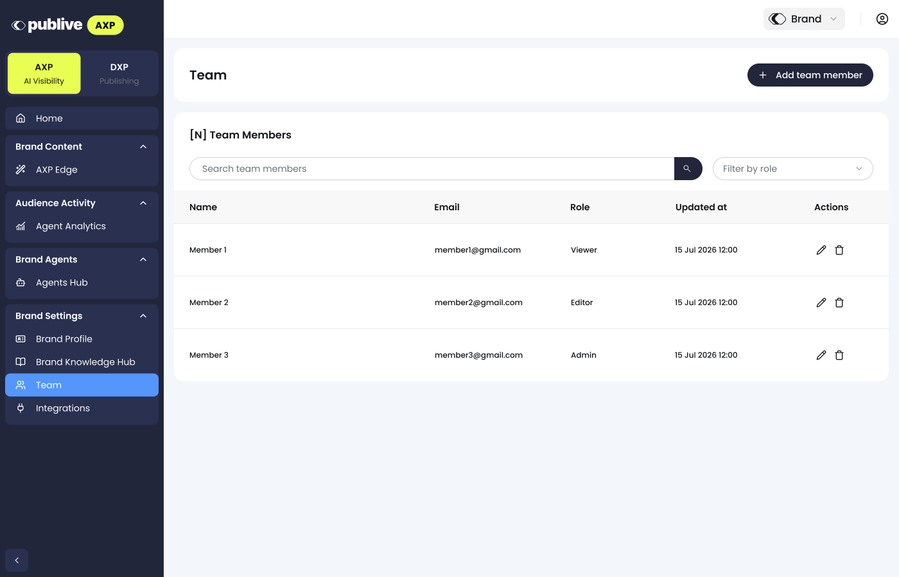
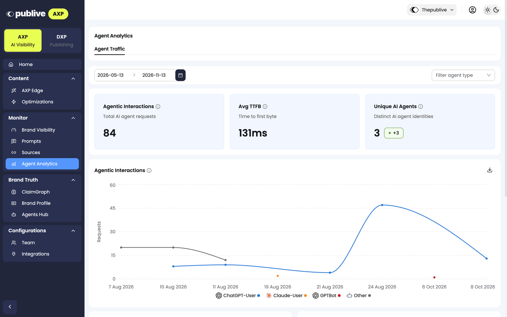
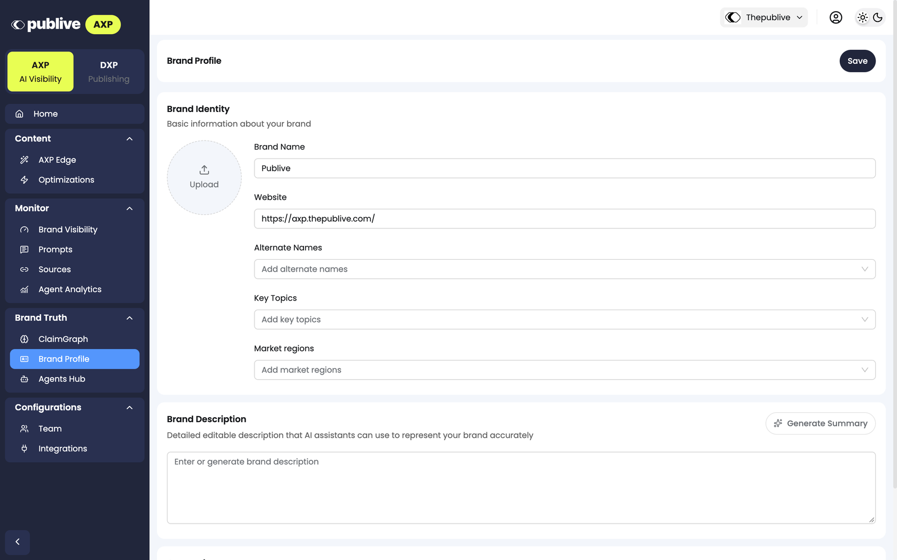

<Tip>
  Subscribe to this changelog via RSS at `https://docs.thepublive.com/changelog/axp/rss.xml`: paste the URL into Slack (`/feed subscribe`), an RSS reader, or a tool like Zapier to get notified of new releases.
</Tip>

<Update label="November 17, 2026" tags={["New releases", "Improvements"]} rss={{ title: "Prompt Suggester, competitors as Brand Profiles, bulk prompt upload by CSV, and Heading Hierarchy Repair" }}>
  ### Prompt Suggester: find the prompts to track

  [Prompt Suggester](/axp/monitor/suggested-prompts) is a new part of Brand AI Observability. It finds the questions that your buyers ask AI assistants. You can then track more prompts than the prompts that you think of yourself.

  * **Four sources of suggestions** — AXP writes suggestions from your topics, the products in your Brand Profile, or a page in AXP Edge. It also writes suggestions from keywords that you import, for example a Google Search Console export.
  * **Data for each suggestion** — each suggestion shows its topic, search volume, intent, and if it mentions your brand. Accept a suggestion to start tracking it. You can accept one suggestion or many suggestions at a time.
  * **Prompts that do not name your brand** — at least 70% of suggestions do not mention your brand. These prompts show if AI assistants find you when buyers ask general questions.
  * **Checks before you see a suggestion** — a second AI model reviews each suggestion. AXP removes suggestions with prices, numbers, or brands that are not in your Brand Profile or keywords. It also removes suggestions that are similar to a prompt that you track or to a suggestion that you rejected.

  <Frame>
    
  </Frame>

  ### Add prompts in bulk

  * **CSV upload** — on the [**Prompts**](/axp/monitor/track-prompts) page, upload a CSV file to add many prompts at once.
  * **Bulk topic assignment** — select many prompts. Then assign them to a [topic](/axp/monitor/track-prompts#topics) in one step.

  ### Competitors as Brand Profiles

  * Each competitor now has its own [Brand Profile](/axp/axp-edge/dashboard#brand-profile), with a status: suggested, accepted, or rejected.
  * AXP shows the brands that it finds in AI responses as suggested competitors. You can accept or reject each one.
  * When you rename a brand, AXP keeps its history. A brand can have more than one domain.
  * AXP moved your existing competitor lists to the new Brand Profiles automatically.

  ### Improvements

  * **Heading Hierarchy Repair** — this new [optimization](/axp/axp-edge/optimizations) repairs the heading structure that AI agents get. For example, it repairs a missing or duplicate H1, or skipped heading levels. The heading text and anchor links do not change. Human visitors see no change. To turn it on, use its switch on the **Optimizations** page.
  * **Multi-select response filters** — you can now filter prompt responses across all platforms at once. Each filter also lets you select more than one value.
  * **Instant page optimization** — when you optimize one page from the dashboard, AXP Edge now renders the page immediately. The status of the page changes to **Optimized**. You do not wait for the next optimization cycle.
</Update>

<Update label="November 3, 2026" tags={["New releases", "Improvements"]} rss={{ title: "Prompt Monitoring in AI Streams, and Global Rules updates" }}>
  ### Track how AI platforms answer your audience's questions

  [Prompt Monitoring](/axp/monitor/overview) shows whether your brand and content appear in AI-generated answers.

  * Track questions by topic group. See the full answer each AI platform gives for each question, along with its [metrics](/axp/monitor/metrics).
  * [Brand Visibility](/axp/monitor/brand-visibility) shows how often AI answers mention your brand compared to others. [Sources](/axp/monitor/sources) shows which pages AI platforms cite and which questions triggered them.
  * The feature [suggests prompts](/axp/monitor/suggested-prompts) to track based on your Brand Profile.

  <Frame>
    
  </Frame>

  ### Improvements

  * **Global Rules** — [Global Rules](/axp/axp-edge/dashboard) now take effect as soon as you save them. A rule can target specific bots. You can drag rules to change their order.

  <Frame>
    
  </Frame>
</Update>

<Update label="August 25, 2026" tags={["Improvements"]} rss={{ title: "Faster AXP Edge response times and CDN cache invalidation" }}>
  ### Improvements

  * **AXP Edge response time** — median response time is down from ~500ms to ~250ms, following edge passthrough-mode and autoscaling improvements.
  * **Auto refresh CDN cache** — a new [cache-invalidation webhook](/axp/axp-edge/integrations/cache-invalidation) keeps AXP Edge synced with your content. Call it alongside your existing CDN purge on publish, update, or unpublish, and AXP Edge serves AI crawlers a fresh render instead of a stale cached one.
</Update>

<Update label="August 11, 2026" tags={["New releases", "Improvements"]} rss={{ title: "Prompt tracking, Diff Checker, Team page, and multi-CDN support" }}>
  ### AXP Streams: Prompt tracking

  * The new **Prompts** page tracks your brand's AI visibility against a set of prompts, measured on real AI assistant responses, with topic, volume, sentiment, citations, and the bots each prompt was seen on.

  <Frame>
    
  </Frame>

  ### AXP Edge: Diff Checker

  * A side-by-side view of any URL's raw HTML versus what AXP Edge serves to AI bots, with the share of content visible to AI before and after.

  <Frame>
    
  </Frame>

  ### Team page

  * A new **Team** page to view, add, edit, and remove team members, with search and filtering by role.

  <Frame>
    
  </Frame>

  ### Multi-CDN support for AXP Edge

  * AXP Edge now runs on [Vercel](/axp/axp-edge/integrations/vercel), [Cloudflare](/axp/axp-edge/integrations/cloudflare), [CloudFront](/axp/axp-edge/integrations/cloudfront), [Akamai](/axp/axp-edge/integrations/akamai), and [F5 XC](/axp/axp-edge/integrations/f5-xc), including path-based URI handling for compatibility across these setups. Each CDN has its own integration guide.
</Update>

<Update label="July 28, 2026" tags={["New releases"]} rss={{ title: "Introducing Agent Analytics" }}>
  ### Agent Analytics

  The new **Agent Analytics** page is live for monitoring AI bot traffic, interactions, success rate, time-to-first-byte, and top & bottom movers (percentage change in AI bot hits to a URL).

  <Frame>
    
  </Frame>
</Update>

<Update label="July 14, 2026" tags={["New releases", "Improvements"]} rss={{ title: "Content Page and Global Rules" }}>
  ### Content Page and Global Rules

  * A new **Content** page shows how your content is being surfaced to agents.
  * A new **Global Rules** page lets you control how AXP Edge treats requests across your entire site from one place. **Bot Override Controls:** The bot override field now accepts multiple AI bots at once, so you can manage rules across several agents in a single update.
</Update>

<Update label="June 30, 2026" tags={["New releases"]} rss={{ title: "Introducing AXP Edge" }}>
  ### Introducing AXP Edge

  We're launching **AXP Edge**, an edge-rendering layer that sits in front of your existing site on your CDN and serves AI agents a clean, agent-first version of your content.

  * At the edge, requests are split by requester type before they reach your origin. Humans and SEO bots pass straight through to your site, byte-for-byte identical to what they get today. AI agents (ChatGPT, Gemini, Perplexity, and similar) get a server-side-rendered, token-optimized version of the same page, stripped of navigation chrome and scripts so only the structured content an agent needs to read and cite remains.
  * It isn't cloaking. AI agents see the same facts as everyone else, restructured for parsing rather than layout. Search engines are treated exactly like human visitors, so your existing SEO stays intact.
  * Pages served through AXP Edge use roughly 90% fewer tokens than the standard human page, and brands running it on already-indexed pages have seen roughly 15-20% more AI citations from the same content.
  * It fails safe. If the edge layer is ever unavailable, requests fall straight back to your normal site.
  * See [AXP Edge: Overview](/axp/axp-edge/overview) for how it works, or [Getting started](/axp/axp-edge/setup) to connect your CDN and go live in under two hours.
</Update>

<Update label="June 25, 2026" tags={["New releases"]} rss={{ title: "Introducing Brand Profile" }}>
  ### Brand Profile

  A new **Brand Profile** page lets you define and manage your brand's presence for AI agents.

  <Frame>
    
  </Frame>
</Update>

<Update label="June 11, 2026" tags={["New releases"]} rss={{ title: "Introducing the AXP Dashboard" }}>
  ### Introducing the AXP Dashboard

  We're launching the **AXP Dashboard**, a single place to manage how AI agents discover, read, and cite your content. It's the foundation we'll build on over the coming weeks.

  * The dashboard is your home for shaping and measuring your brand's presence with AI agents.
  * It's rolling out gradually. [Contact Publive](https://axp.thepublive.com/contact) to improve your AI visibility.
</Update>
