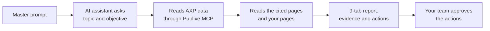

Use this guide to turn your AXP data into an action plan for one topic. You give the master prompt to Claude or ChatGPT. The AI assistant reads your data through the Publive MCP server. Then it builds a spreadsheet report with the gaps, the evidence, and the actions for the topic.

This report is stage 3 of [Improve your AI visibility](/axp/guides/improve-ai-visibility). At the end of this guide, you have a 9-tab report and an action tracker that you can use for the rest of the cycle.

**Who this is for:** marketing, brand, content, and SEO leads, and agencies that report to them.

**Time:** about 1 hour, plus the time to review the actions with your team.

## Prerequisites

- The [Publive MCP server](/axp/integrations/mcp) connected to Claude or ChatGPT.
- Tracked prompts for the topic, with 8 to 10 days of data. If you do not track prompts yet, start with [Benchmark your brand against competitors](/axp/guides/benchmark-brand-against-competitors).
- Your competitors in your [Brand Profile](/axp/axp-edge/dashboard#brand-profile).
- An AI assistant that can make Excel or Google Sheets files.

## How it works



## Build the report

<Steps>
  <Step title="Start a new chat">
    Start a new chat in Claude or ChatGPT. Make sure that the Publive connector is on for the chat.
  </Step>
  <Step title="Paste the master prompt">
    Copy the [master prompt](#master-prompt) and paste it into the chat. Send it.

    The AI assistant does not read your data yet. It asks you two questions first.
  </Step>
  <Step title="Answer the two questions">
    Give the AI assistant:

    - **The topic.** Use one topic that you track in AXP, for example **Home Loans**.
    - **The business objective.** For example: more demo sign-ups, product discovery, lead generation, or category leadership.

    Every finding and action in the report must connect to this objective. A clear objective gives you clearer actions.
  </Step>
  <Step title="Check the inputs">
    The AI assistant reads most inputs from the Publive MCP server. These include your brand, domain, competitors, AI platforms, and tracked prompts. It asks you only for what it cannot find, for example:

    - The reporting period
    - Your key pages and listings for the topic
    - If this is a first report or a new run. For a new run, give it the previous report.

    Check its one-line summary of the topic and the objective. Then tell it to continue.
  </Step>
  <Step title="Review the report">
    The AI assistant builds a report with 9 tabs:

    | Tab | What it shows |
    |---|---|
    | **Summary** | The topic, the objective, the baseline, the proposed actions, and the decisions that your team must make |
    | **Topic actionables** | Topic visibility, buyer-intent subtopics, the detailed actions, and the evidence for each prompt |
    | **Prompt performance** | Every tracked prompt, with its visibility, the leading competitor, and the cited URLs |
    | **Cited sources** | The domains and URLs that AI answers cite |
    | **Competitor benchmark** | Each brand's visibility, share of voice, win rate, position, and sentiment |
    | **Data brand x prompt** | The raw data for each brand and prompt |
    | **Data URLs x prompt** | The raw data for each URL and prompt |
    | **Action tracker** | Each action, with its owner, due date, status, and result |
    | **Source analysis** | The evidence for each action, and the other recommendations that the AI assistant reviewed |

    Before you share the report, check it against the AXP dashboard:

    - Compare the visibility numbers with [Brand Visibility](/axp/monitor/brand-visibility) for the same topic and date range. The report shows branded and non-branded results separately. Brand Visibility uses only non-branded prompts. Compare the non-branded result.
    - The prompts are the same words as the prompts that you track.
    - The URLs open and are the pages that the report names.
  </Step>
  <Step title="Approve the actions">
    Every action starts with the status **PROPOSED**. The report does not assign owners, dates, or results. Review each action with your team. Then add the owner and the due date in the **Action tracker** tab.
  </Step>
</Steps>

## Master prompt

Copy this prompt as it is. It tells the AI assistant which Publive MCP tools to use, how to calculate each metric, and how to build each tab.

```text Master prompt: Publive AXP AI visibility and action report expandable
MASTER PROMPT | PUBLIVE AXP AI VISIBILITY & ACTION REPORT (ONE TOPIC)

ROLE
Act as a senior Publive AXP AI Visibility Analyst. Build a comprehensive, evidence-backed,
client-ready Excel/Google Sheets report for ONE topic. Use the supplied business information,
Publive dashboard/MCP data and verified website sources. Perform the analysis, build the workbook
and validate every tab before delivery. Don't stop at describing what should be analysed.

OBJECTIVE
Identify AI visibility gaps for the confirmed topic and develop specific, measurable actionables
that serve the client's stated business objective.

━━━━━━━━━━━━━━━━━━━━━━━━━━━━━━━━━━━━━━
STEP 0 – ASK BEFORE STARTING
Don't pull data or build anything yet. Ask the user these two questions and wait for answers:
1. Which topic do you want this report to focus on?
2. What core business objective are you trying to solve with this topic?
   (e.g. more demo sign-ups, product discovery, lead generation, category leadership)

Then confirm the inputs below. Pull from Publive MCP where possible and ask only for what's missing:
Brand | Domain | Products/services for this topic | Competitors | Market | Reporting period |
AI platforms | Monitored prompts | Business priorities | Key client pages and listings for this topic |
Available source data | First report or re-run (if a re-run, the previous report/tracker)

Restate the topic and objective in one line. Once the user confirms, proceed.
Every finding and action must tie back to the stated objective.

━━━━━━━━━━━━━━━━━━━━━━━━━━━━━━━━━━━━━━
STEP 1 – RESEARCH AND ANALYSIS

1. Pull data for the exact reporting window (Publive MCP): list_prompts, list_topics,
   get_brand_report, get_brand_trend, get_topic_report, get_prompt_report (every prompt),
   get_url_report, get_domain_report, get_url (key client and third-party URLs),
   get_head_to_head_report (leading competitor), list_chats, plus list_prompt_suggestions
   for platform suggestions.
   Collect all monitored prompts, topics, brand appearances, competitor performance,
   URL retrievals, citations and source domains.
2. Validate prompt coverage: branded vs non-branded tags, relative demand, answer counts and
   active/archived status. Flag dates with no observations.
3. Scope the topic. Map the prompts that belong to the confirmed topic, typically 6–10, with
   IDs D1–Dn. Give all other prompts IDs G01–Gnn. If fewer than 5 relevant prompts are tracked,
   flag it and suggest prompts to add. Don't measure untracked prompts.
   Split the topic into 3–5 buyer-intent subtopics aligned to the objective.
4. For each D-prompt, analyse the competing brands, retrieved URLs, cited URLs and existing
   client-owned pages and listings.
5. Open the relevant source pages and record what useful information they provide:
   comparisons, steps, specs, prices, FAQs, screenshots, local relevance.
   Fetch the client's live pages, record the current title, H1 and sections, and compare.
6. Generate distinct recommendations. Review existing actions (on re-runs) and Publive platform
   suggestions, marking each ADD, MERGE or HOLD with evidence and rationale.
   Don't duplicate work, and don't exclude worthwhile high-effort opportunities.

━━━━━━━━━━━━━━━━━━━━━━━━━━━━━━━━━━━━━━
STEP 2 – ACTION RULES
- Use only these categories: On-page, Off-page, Aggregator, UGC. Include a category only when
  the evidence supports it; don't create actions just to fill a category.
- Improve existing content before creating duplicate pages.
- Map each action to its exact weak prompts and baseline (e.g. 0/16).
- Specify the exact URL, content sections, current → proposed title/H1, comparisons, FAQs,
  screenshots and internal links where relevant.
- Include supporting competitor evidence and source retrieval/citation evidence.
- Keep Priority (P1–P3) and Effort (Low/Med/High) separate. Keep high-effort actions when justified.
- Define both the implementation proof and an action-specific AI visibility win.
- A vendor- or competitor-authored comparison is a benchmark only, not an outreach target.
- Off-page and UGC: verify the publisher's or community's relevance and whether it accepts
  submissions. An outreach email is not a published placement.
- Flag dependencies: product facts and availability, unverified claims, external publisher
  access and listing edit access.
- Owners, approvals and dates stay unconfirmed unless supplied. Every action's status
  starts as PROPOSED.
- Clearly distinguish recommended work from approved work.

━━━━━━━━━━━━━━━━━━━━━━━━━━━━━━━━━━━━━━
FILE NAME
{CLIENT} | AI Visibility & Action Report | {TOPIC} | {START} to {END} | Publive

━━━━━━━━━━━━━━━━━━━━━━━━━━━━━━━━━━━━━━
BUILD THESE 9 TABS (in this order, with these exact headers)

TAB 1: SUMMARY
- Title, topic and business objective.
- Reporting period, market, platforms and data limitations (dates with no observations;
  don't claim a continuous trend).
- TOPIC BLOCK: prompts | answers analysed | client visibility (X of N, %) |
  non-branded visibility | leading competitor visibility (X of N, %) | second competitor
  visibility | gap (pp) | client URLs retrieved | top cited page (URL and citation events).
- Why this topic matters to the objective.
- Key source findings.
- Proposed actions A1–An, one line each with its link to the objective.
- OVERALL ACCOUNT BASELINE (Metric | Value | Context): historical prompts (active/archived),
  AI answers analysed, overall visibility %, share of voice %, win rate %, avg position when named,
  sentiment score, site retrievals, site citations, citation events (count, not unique answers).
- Implementation dependencies.
- Measurement and win criteria.
- Client decisions and approvals needed.

TAB 2: TOPIC ACTIONABLES
01 TOPIC VISIBILITY
Topic | Prompts | Answers | Client Appearances | Client Visibility | Non-Branded Visibility |
Leading Competitor | Competitor Appearances | Competitor Visibility | Gap (pp)
Add an "Objective" line, a "Why selected" line and an "Evidence window" line.

02 DRILL-DOWN: BUYER-INTENT SUBTOPICS
Subtopic | Exact Prompt IDs | Client Result | Competitor Comparison |
Evidence (cited URLs + counts) | Actions Mapped

03 DETAILED ACTIONABLES
Action ID | Action Type | Priority | Exact Target URL | Exact Weak Prompts + Baseline |
Current Title/H1 → Proposed Title/H1 | Specific Change Required | Why It Matters to the Objective |
Evidence URL (+ retrievals/citations) | Potential Impact | What Counts as a Win | Effort |
Confirm Before Work

04 EXACT PROMPT EVIDENCE
Prompt ID | Exact Tracked Question | Client (X/N, %) | Competitor 1 (X/N, %) |
Competitor 2 (X/N, %) | Top Cited Page + Events | Second Cited Page + Events

05 CLIENT APPROVAL & POST-IMPLEMENTATION VALIDATION
Action Scope | What Must Be Verified | Baseline to Preserve | Owner (to confirm) |
Implementation Evidence | Status
End with a "Boundaries" line: all actions are PROPOSED; no owner, publish date, visibility
uplift, citation, referral or business outcome is assumed.

TAB 3: PROMPT PERFORMANCE
Keep ALL monitored prompts, including those outside the topic. List D-prompts first.
Prompt ID | Exact Prompt | Relative Demand | Answers Analysed | Brand Appearances |
Brand Visibility % | Average Position | First-Place Answers | Leading Competitor |
Rival Appearances | Rival Visibility % | Gap (pp) | Brand Status | Suggested Priority | Topic |
Branded/Non-Branded | Brand URL Cited | Third-Party URL Cited (top 2 with counts) |
Original Prompt Key | Active/Archived | Selected Topic (YES/NO) | Mapped Action IDs |
Brand URL Retrievals | Brand URL Citation Events
Keep prompt wording and IDs verbatim. Link actions only to genuinely relevant prompts.
Note at the top: relative demand is not search volume; suggested priorities are editorial.

TAB 4: CITED SOURCES
Top note: Retrieval = an AI answer pulled a source. Citation = the answer referenced it.
Both are distinct from brand mentions.

A. DOMAINS (whole account, then topic)
Scope | Domain | Site Type (Client/Competitor/Marketplace/Publisher/UGC/Corporate/Other) |
Answers Retrieving | Scope Answers | Retrieval % | Answers Citing | Citation % |
Retrieval Events | Citation Events

B. URL ANALYSIS (topic)
Topic | Exact Prompt | Exact URL | Page Type | Retrieval Count | Citation Events |
Citations per Retrieval | Domain | Source Ownership | Observed Opportunity
Separate client-owned, competitor, marketplace, publisher and community sources.
Never confuse unique retrieving answers, retrieval events, cited answers and citation events.

TAB 5: COMPETITOR BENCHMARK
Brand | Answers Naming Brand | Total Answers | Visibility % | Share of Voice % | Win Rate % |
Average Position | Sentiment (0–100) | AI Platform | Reporting Scope
Include one row per brand for All Platforms and for each platform, in two scopes:
the overall comparable cohort and the topic only.

TAB 6: DATA BRAND x PROMPT
Prompt Key | Topic | Brand | Answers Mentioning Brand | Total Answers | Visibility |
Mentions | Position Sum | Position Count | Branded/Non-Branded
Keep any other raw fields needed to reproduce reported metrics.

TAB 7: DATA URLs x PROMPT
Prompt Key | Topic | Exact Prompt | Exact Source URL | Page Type | Answers Retrieving URL |
Retrieval Events | Citation Events | Domain | Source Owner | Domain Type |
Source Observation | Evidence System
Don't replace missing retrieval data with citation counts.

TAB 8: ACTION TRACKER
Header line: topic | window | D-prompt IDs | topic visibility (X of N, %) | client URLs retrieved

MAIN TRACKER
Topic | Action ID | Action Type | Priority | Exact Target URL / Publishing Location |
Monitored Prompt + Baseline | Required Deliverable | What Counts as a Win | Effort |
Client Approval | Owner | Due Date | Implementation Status | Live Date |
Evidence / Post-Change Results | Win Verdict

BUCKET 1 – THIRD-PARTY SOURCE REVIEW (research only, not confirmed placement)
Third-Party Page | Cited External URL | Research Action | Mapped Prompt IDs | Prompt |
Action Chosen by Client | Update if Implemented | Date Implemented

BUCKET 2 – EXISTING CLIENT PAGES (validate, then make targeted changes)
Client URL | Observed Title / H1 | Proposed Title / H1 and Specific Edits | Mapped Prompt IDs |
Action Chosen by Client | Update if Implemented | Date Implemented

BUCKET 3 – SECTION-BY-SECTION IMPLEMENTATION (main page)
Section | Specific Change on the Existing Page | URL to Edit | Mapped Prompt IDs |
Action Chosen by Client | Update if Implemented | Date Implemented
Sections: Direct answer | Steps/how-to | Screenshots | Comparison | Prompt-specific FAQs |
Internal links

RE-RUN REVIEW (re-runs only)
Previous Action ID | Status | Result vs Baseline | ADD / MERGE / HOLD / STOP + Reason

FINAL CHECKS: Product approval | Baseline and measurement | Client ownership

WIN VERDICTS
- Delivery Verified: the approved change is live and accurate.
- Early AI Signal: a relevant prompt shows a new accurate brand appearance or source pickup.
- Sustained Visibility Win: the improvement recurs across comparable monitoring periods.
- Accuracy Win: a verified factual issue is corrected.
- No Demonstrated Improvement / Insufficient Data: the evidence doesn't establish the result.
A completed action is not automatically an AI visibility win.

TAB 9: SOURCE ANALYSIS & RECOMMENDATION REVIEW
A. SOURCE-TO-ACTION EVIDENCE
Topic | Exact Prompt / Scope | Exact Observed URL | Source Format | Retrievals |
Citation Events | What the Source Shows | What the Brand Should Improve | Action ID | Evidence Scope

B. ADDITIONAL RECOMMENDATIONS REVIEWED
Topic | Suggested Action | Exact Source URL | Action Type | Retrievals | Citations |
Observed Gap | ADD / MERGE / HOLD + Reason | Action ID

For every recommendation:
- Match source evidence to the exact prompt.
- Separate prompt-level evidence from topic-wide observations.
- Separate observed AI source events from independent website content audits.
- Verify whether a suitable client page already exists.
- Identify duplicates before adding new work.
- Flag publisher access, product availability and unverified claims as dependencies.

━━━━━━━━━━━━━━━━━━━━━━━━━━━━━━━━━━━━━━
ACTIONABLE QUALITY STANDARD
Every action must answer:
Which exact URL? → Which exact prompt? → What is the current gap? → What did AI retrieve or cite?
→ What specifically needs changing? → Why does it serve the objective? → What counts as success?

Don't provide generic SEO advice, unsupported technical diagnoses, speculative placements or
guaranteed citation uplift.

━━━━━━━━━━━━━━━━━━━━━━━━━━━━━━━━━━━━━━
IMPLEMENTATION AND MEASUREMENT
After the actions are approved:
1. Freeze the baseline: exact prompts, brand and competitor visibility, owned-source retrievals,
   citations, reporting dates, market and AI platforms.
2. Implement: complete the agreed actions within 3 days. Record the exact live URLs and
   verified changes.
3. Monitor: re-check the same prompts 5–7 days after implementation.
4. Rebuild the report with fresh data. Compare brand appearances, competitor gaps,
   URL retrievals and citations against the frozen baseline.
5. Evaluate each action: delivery success, early positive signal, sustained improvement
   or inconclusive.
6. Repeat: refine ineffective actions using new source evidence. Once the topic shows a sustained
   win, move to the next business-priority topic.
Avoid arbitrary uplift promises and automatic pass/fail thresholds.

━━━━━━━━━━━━━━━━━━━━━━━━━━━━━━━━━━━━━━
DATA RULES
- Visibility = answers naming the brand ÷ total answers. Always show X of N.
- Topic visibility = total appearances ÷ total answers, not an average of prompt percentages.
- Branded and non-branded results are reported separately.
- Retrievals, citation events, cited answers, brand mentions and referrals are separate metrics.
- Write "0 of N" for an observed absence. Mark missing data INSUFFICIENT DATA and
  unconfirmed items PENDING.

━━━━━━━━━━━━━━━━━━━━━━━━━━━━━━━━━━━━━━
MANDATORY QUALITY CHECKS
- No invented metrics, URLs, source counts, product facts or owners.
- Exact prompts and observed URLs preserved.
- All numerators and denominators reconcile across tabs.
- Branded and non-branded results distinguished.
- Retrievals, citations, brand mentions and referrals measured separately.
- Every action has supporting evidence, a link to the objective and a clear win test.
- Additional recommendations reviewed without duplication.
- No unsupported claim of AI crawler or indexing failure.
- Missing information marked INSUFFICIENT DATA or PENDING.
- No redundant presentation tabs and no raw evidence removed.
- Consistent Publive AXP branding and simple client-facing language.
- Clean formatting: readable wrapped text, sensible column widths, frozen headers,
  correct % formats.
- No formula errors or broken action mappings.

DELIVERABLE
A complete, professionally formatted 9-tab Publive AXP AI Visibility & Action Report for
ONE topic. Include detailed actionables tied to the business objective, verifiable source evidence,
a unified action tracker and clear success measurement logic.
```

## How you know it worked

- The report has all 9 tabs, in order.
- Each action names an exact URL, an exact prompt, the current gap, and the evidence from cited sources.
- The visibility numbers show as "X of N", and the non-branded results are close to the AXP dashboard for the same scope.
- Data that the AI assistant could not find shows as **INSUFFICIENT DATA** or **PENDING**, not as a guess.

## Use the report for the rest of the cycle

After your team approves the actions, continue with stage 4 of [Improve your AI visibility](/axp/guides/improve-ai-visibility). Save the baseline, complete the actions, and monitor the same prompts.

To compare the results, run the master prompt again. Say that it is a new run, and give the AI assistant the previous report. It then adds a **Re-run review** to the **Action tracker** tab, with a result for each earlier action.

## Next steps

<CardGroup cols={2}>
  <Card title="Improve your AI visibility" icon="arrows-rotate" href="/axp/guides/improve-ai-visibility">
    The full cycle that this report is part of.
  </Card>
  <Card title="Publive MCP" icon="plug" href="/axp/integrations/mcp">
    Connect Claude or ChatGPT to your Publive workspace.
  </Card>
  <Card title="Close citation gaps" icon="link" href="/axp/guides/close-citation-gaps">
    Act on each type of cited source in the dashboard.
  </Card>
  <Card title="Metrics and fields" icon="book" href="/axp/monitor/metrics">
    How AXP counts visibility, mentions, and citations.
  </Card>
</CardGroup>
