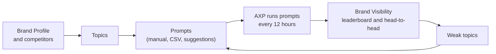

Use this guide to see how often AI assistants recommend your brand when buyers ask about your market. You compare the result with your competitors. At the end, you have:

- Tracked prompts, grouped by topic
- A baseline for each metric
- A list of the topics where competitors win

**Who this is for:** marketing, brand, and growth leads who use the AXP dashboard.

**Time:** about 1 hour to set up. The first data shows after the first run, and trends show after a few weeks.

## Prerequisites

- Access to the AXP dashboard. AXP Edge does not have to be live for this guide.
- A list of your main competitors and your product lines.
- Optional: a keyword export from Google Search Console or an SEO tool, as a CSV file.

## How it works

## Set up the benchmark

<Steps>
  <Step title="Complete your Brand Profile and competitors">
    Open **Brand Profile** in the **Brand Truth** group of the sidebar. Fill in your brand identity and the brand description. Then go to **Competitors**:

    - Add the competitors that you want to compare with.
    - Accept or reject the competitors that AXP suggests from AI responses.

    AXP uses your brand name, domains, and competitors to find each brand in the responses. If a competitor is missing, the head-to-head comparison cannot show it. Refer to [Brand Profile](/axp/axp-edge/dashboard#brand-profile).
  </Step>
  <Step title="Create one topic for each product line or buyer need">
    On the **Prompts** page, click **Add topic**. Create 3 to 5 topics, for example **Personal Loans**, **Home Loans**, and **Credit Cards**.

    Brand Visibility shows your results for each topic. Topics that match how your team plans its work make the results easier to act on. Refer to [Topics](/axp/monitor/track-prompts#topics).
  </Step>
  <Step title="Add the prompts that you already know">
    Add the questions that your buyers ask, for each topic:

    - To add one prompt, click **Add prompt**. Write the question as a buyer types it into an AI assistant.
    - To add many prompts, [upload a CSV file](/axp/monitor/track-prompts#add-prompts-in-bulk).

    Most of your prompts must not name your brand. Write "Which bank is best for MSME loans in Delhi?", not "Is Acme Bank good for MSME loans?". Brand Visibility counts only the prompts that do not mention your brand. A prompt that names your brand almost always gets an answer that names your brand.

    <Tip>
      Set a **Location** on a prompt when the answer depends on the market, for example `Mumbai, India`. The location changes the sources that the AI finds.
    </Tip>
  </Step>
  <Step title="Add prompts from your keyword data">
    On the **Suggested** tab, click **Import keywords** and upload your keyword CSV file. AXP turns the keywords into prompts in 2 to 3 minutes. To get more suggestions for your topics, click **Suggest more**.

    Accept the suggestions that a buyer would really ask. Reject the others, so that AXP does not suggest similar prompts again. Refer to [Suggested prompts](/axp/monitor/suggested-prompts).

    Each accepted prompt counts toward your [prompt limit](/axp/monitor/track-prompts#prompt-limit). Keep 5 to 15 prompts for each topic, so that each topic has enough responses to compare.
  </Step>
  <Step title="Wait for the first runs">
    AXP sends each tracked prompt to ChatGPT and Gemini every 12 hours. After the first run, the metric columns on the **Tracking** tab show values.

    Check for prompts that have no answered responses or a low **Web search** value. A low web search value means that the platform answers from its own knowledge. These prompts can change more slowly.
  </Step>
</Steps>

## Read the benchmark

<Steps>
  <Step title="Get your baseline">
    Open **Brand Visibility** in the **Monitor** group of the sidebar. Note the five headline cards: **AI visibility**, **Sentiment score**, **Share of voice**, **Citations**, and **Citation rate**. These values are your baseline.

    For the meaning of each metric, refer to [Metrics and fields](/axp/monitor/metrics).
  </Step>
  <Step title="Find the brands that lead">
    Look at the **Brand leaderboard**. Rank it by **Visibility**, then by **Share of Voice**. The brands at the top are the brands that AI assistants recommend most in your market. They can include brands that are not on your competitor list.
  </Step>
  <Step title="Compare with your main competitor">
    In **Head-to-head**, select your main competitor. Compare share of voice, AI visibility, citations, sentiment, and average position. Repeat for each important competitor.
  </Step>
  <Step title="Find your weak topics">
    In **Brand insights**, compare the topics. A weak topic has low **Visibility** or **Share of Voice**, or a high (worse) **Position**.

    Click **View tracked prompts** on a weak topic. Then open a prompt to see its [prompt analytics](/axp/monitor/prompt-analytics):

    - **Top performing brands** shows which brands win this prompt.
    - **Top domains** and **Top URLs** show the sources that the AI uses for its answer.
    - Open a response to read exactly what the AI said about each brand.
  </Step>
  <Step title="Act on the weak topics">
    - To see if the gap is real, add more prompts to the weak topic. One prompt is not enough to show a pattern.
    - To find the pages that shape the answers, follow [Find the sources AI cites, and close the gaps](/axp/guides/close-citation-gaps).
  </Step>
</Steps>

## How you know it worked

- The **Tracking** tab shows metric values for your prompts, and the **Brand Visibility** cards show your baseline.
- Each important competitor shows in the **Brand leaderboard** and in **Head-to-head**.
- After a few weeks, **Visibility over time** shows a trend for your brand and your top competitors. Each metric also shows the change from the previous period of the same length.

## Next steps

<CardGroup cols={2}>
  <Card title="Close citation gaps" icon="link" href="/axp/guides/close-citation-gaps">
    Find the pages that AI cites in your market, and improve your own pages.
  </Card>
  <Card title="Brand Visibility" icon="eye" href="/axp/monitor/brand-visibility">
    Every section and control on the Brand Visibility page.
  </Card>
  <Card title="Track prompts" icon="list-check" href="/axp/monitor/track-prompts">
    Edit, pause, and organize your tracked prompts.
  </Card>
  <Card title="Metrics and fields" icon="book" href="/axp/monitor/metrics">
    How AXP calculates each metric.
  </Card>
</CardGroup>
