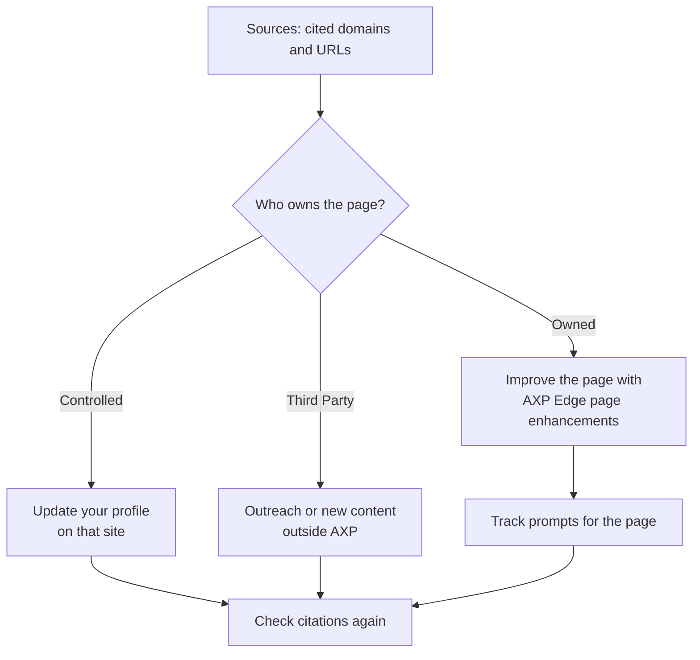

AI assistants build their answers from the pages that they cite. Use this guide to find those pages, see which of them leave your brand out, and make your own pages easier for AI to cite. At the end, you have a list of the sources that shape AI answers in your market, and a plan for each type of source.

**Who this is for:** content, SEO, and PR leads who use the AXP dashboard.

## Prerequisites

- Tracked prompts with at least a few runs of data. If you have no tracked prompts yet, start with [Benchmark your brand against competitors](/axp/guides/benchmark-brand-against-competitors).
- Your domains in your [Brand Profile](/axp/axp-edge/dashboard#brand-profile), so that AXP can find your own pages.
- For the steps on your own pages: AXP Edge live on your domain. Refer to [Getting started](/axp/axp-edge/setup).

## How it works

## Find the sources that shape AI answers

<Steps>
  <Step title="Open Sources">
    Open **Sources** in the **Monitor** group of the sidebar. Set the date range to the last 30 days or more.

    Sources uses only the responses to prompts that do not mention your brand. So it shows the sources that the AI uses when a buyer asks a general question. Refer to [Sources](/axp/monitor/sources).
  </Step>
  <Step title="Find the domains that the AI cites most">
    On the **Domains** page, sort by **Citations**. Note the top 10 domains and their **Domain type**:

    - **You** is one of your own domains.
    - **UGC** is a forum, review site, or social platform.
    - **Corporate** is a company website, often a competitor.
    - **Institutional** is a government body, regulator, or university.

    If your own domains are not near the top, AI assistants use other sites to describe your market.
  </Step>
  <Step title="Find the cited pages that leave your brand out">
    Open the **URLs** page and sort by **Citations**. Look for pages where **Your brand mentioned** is **No**. These pages shape the AI answers in your market without your brand.

    Open a page to see its URL details:

    - **Ownership** shows who controls the page: **Owned**, **Controlled**, or **Third Party**.
    - **Prompt insights** shows which of your prompts cite the page.
    - **Brands mentioned** shows which competitors the page names.

    <Note>
      AXP reads each cited page in the background. Until it reads the page, the type, ownership, and brand fields show "–".
    </Note>
  </Step>
</Steps>

## Close the gaps

Use **Ownership** to choose the action for each page.

| Ownership | What it means | What to do |
|---|---|---|
| **Third Party** | A site that you do not control, for example a review site or a comparison article | Work outside AXP: ask the publisher to include your brand, or publish your own page that answers the same question better. |
| **Controlled** | A page that you control on another site, for example your company profile on a directory | Update the page so that it names your brand, your products, and the facts that buyers ask about. |
| **Owned** | A page on your own domain | Make the page easier for AI to read and cite. Use the steps below. |

For your owned pages:

<Steps>
  <Step title="Check that AI agents visit the page">
    Open **Agent Analytics** and search for the page in **URL Performance Analysis**. If AI agents seldom request the page, they cannot cite it. Refer to [Agent Analytics](/axp/axp-edge/agent-analytics).
  </Step>
  <Step title="Turn on page enhancements">
    Open **Optimizations** in the **Content** group. Turn on **Add Relevant FAQs** and **Add LLM-Friendly Summaries**. Then click **Review** on each card, find your page, and click **Apply** on the suggestion.

    AXP makes each addition only from the text of your page. AI agents get it only after you apply it. Human visitors never see it. Refer to [Optimizations](/axp/axp-edge/optimizations).
  </Step>
  <Step title="Track the prompts that the page can answer">
    On the **Content** tab of the **AXP Edge** page, find the page in **All URLs**. In the **Actions** menu, click **Suggest prompts for this URL**. Select the prompts that buyers ask, and click **Start tracking**.

    These prompts show if AI assistants start to cite your page for the questions that it answers. Refer to [Suggest prompts for a page](/axp/monitor/suggested-prompts#suggest-prompts-for-a-page).
  </Step>
</Steps>

## How you know it worked

Give the changes time. AXP reads each cited page again about every 30 days, and AI platforms update their sources at different speeds.

- On **Sources**, your own domains move up in **Citations**.
- On the URL details of your page, **URL citations** goes up and **Prompt insights** lists more prompts.
- On the prompts that you track for the page, the **Citations** column goes up. On [prompt analytics](/axp/monitor/prompt-analytics), your page shows in **Top URLs**.
- On **Brand Visibility**, the **Citations** and **Citation rate** cards go up.

## Next steps

<CardGroup cols={2}>
  <Card title="Benchmark vs competitors" icon="ranking-star" href="/axp/guides/benchmark-brand-against-competitors">
    Compare your brand with your competitors, topic by topic.
  </Card>
  <Card title="Sources" icon="link" href="/axp/monitor/sources">
    Every field and filter on the Sources pages.
  </Card>
  <Card title="Optimizations" icon="wand-magic-sparkles" href="/axp/axp-edge/optimizations">
    Which pages to approve first for each page enhancement.
  </Card>
  <Card title="Metrics and fields" icon="book" href="/axp/monitor/metrics">
    How AXP counts citations and citation rate.
  </Card>
</CardGroup>
