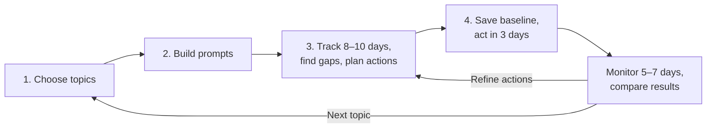

Use this guide to improve how often AI assistants mention and cite your brand. You choose the topics that matter to your business and track the questions that buyers ask. Then you act on one topic at a time and measure the change against a baseline. At the end of each cycle, you know which actions worked, and you choose the next topic.

**Who this is for:** marketing, brand, content, and SEO leads who use the AXP dashboard.

**Time:** about 3 weeks for each cycle. You track for 8 to 10 days, act for 3 days, and monitor for 5 to 7 days.

## Prerequisites

- Access to the AXP dashboard.
- Your Brand Profile and your main competitors. Refer to [Brand Profile](/axp/axp-edge/dashboard#brand-profile).
- A list of your priority products and services, target markets, and buyer personas.
- Optional: AXP Edge live on your domain, for the agent traffic data in stage 1. Refer to [Getting started](/axp/axp-edge/setup).
- Optional: the [Publive MCP server](/axp/integrations/mcp) connected to Claude or ChatGPT, for the action report in stage 3.

## How it works

## Terms in this guide

These two results are different. Do not count one as the other.

- **Brand mention:** the AI answer names your brand.
- **Citation:** the AI answer gives a page as a source.

A brand mention does not mean that the answer cites your website. An answer can also cite your page and not mention your brand. For how AXP counts mentions and citations, refer to [Metrics and fields](/axp/monitor/metrics).

## Stage 1: Choose the topics

Find the topics that matter to your business and that AI agents already read about.

<Steps>
  <Step title="Collect your business inputs">
    Collect this information:

    - Priority products and services
    - Target markets and customer personas
    - Customer questions and buying journeys
    - Main competitors
    - Search keywords, if you have them
    - Questions from sales calls and support tickets
  </Step>
  <Step title="Find the pages that AI agents visit most">
    Open **Agent Analytics** and sort **URL Performance Analysis** by **Agentic Hits**. Note the top 20 pages. They show the parts of your website that AI agents read most often. Refer to [Agent Analytics](/axp/axp-edge/agent-analytics).
  </Step>
  <Step title="Make a shortlist of topics">
    Compare the top 20 pages with your business priorities. Choose the topics that appear in both.
  </Step>
</Steps>

**Result:** a shortlist of topics that are relevant to your business.

## Stage 2: Build the prompt set

Write the questions that your possible customers ask AI assistants about each topic.

<Steps>
  <Step title="Generate questions with an AI assistant">
    Give an AI assistant your inputs from stage 1: topics, competitors, keywords, and the top 20 URLs. Ask it to write customer questions for each step of the buying journey:

    - Discovery
    - Comparison
    - Consideration
    - Purchase
  </Step>
  <Step title="Include branded and non-branded questions">
    A branded question names your brand. A non-branded question does not. Most of your prompts must be non-branded, because AXP measures Brand Visibility on non-branded prompts only.
  </Step>
  <Step title="Review the questions">
    Group the questions under the correct topic. Remove duplicates. Remove questions that are not relevant to your business or that are not correct about your products.

    Write each prompt as a real customer asks it. Do not only repeat product names or SEO keywords.
  </Step>
</Steps>

**Result:** a checked set of prompts, grouped by topic.

## Stage 3: Track the prompts and plan the actions

<Steps>
  <Step title="Track the prompts for 8 to 10 days">
    Add the topics and prompts in AXP. Refer to [Track prompts](/axp/monitor/track-prompts). AXP runs each prompt every 12 hours. 8 to 10 days give you enough responses for a baseline.

    For the setup steps, refer to [Benchmark your brand against competitors](/axp/guides/benchmark-brand-against-competitors).
  </Step>
  <Step title="Analyze the baseline">
    Use the AXP dashboard or the Publive MCP server to find:

    - Your brand visibility for each topic and each prompt
    - Which competitors appear, and how often
    - The prompts where your brand has low or no visibility
    - The citations of your own URLs
    - The citations of competitor URLs
    - The third-party domains and URLs that AI answers cite
    - The gaps between your content and the sources that AI platforms use

    Refer to [Brand Visibility](/axp/monitor/brand-visibility), [Prompt analytics](/axp/monitor/prompt-analytics), and [Sources](/axp/monitor/sources).
  </Step>
  <Step title="Select one topic">
    Select the topic where your business priorities and the largest visibility gap meet. Work on only one topic in each cycle. One topic keeps your actions focused and your measurement clear.
  </Step>
  <Step title="Analyze the sources for the topic">
    For the topic that you selected:

    1. **Find the weak prompts.** These are the prompts where your brand is missing, or where competitors appear more often than your brand.
    2. **Find the sources.** Note the URLs and domains that AI platforms cite for these prompts, and how many times they cite each one.
    3. **Read the sources.** Open the pages that AI platforms cite most. Note the information that they give, for example comparisons, specifications, or direct answers.
    4. **Compare your content.** Check your own pages and your listings on other sites against these sources. Note the missing information and the gaps.
    5. **Find the opportunities.** Decide which pages to improve, which new content you need, and which external sites are worth your time.

    For how to read the Sources pages, refer to [Close citation gaps](/axp/guides/close-citation-gaps).
  </Step>
  <Step title="Write the actions">
    Put each action into one of four types:

    | Action type | What to improve |
    |---|---|
    | **On-page** | Your website content: product information, comparisons, FAQs, and other relevant pages |
    | **Off-page** | Coverage of your brand on independent websites |
    | **Aggregator** | Your product, service, or business listings on third-party platforms |
    | **UGC** | Real reviews, community discussions, and content from creators |

    Each action must state:

    - The exact URL to change
    - The AI prompt that the action is for
    - The current visibility gap of your brand
    - The source URLs that support the action, with their citation counts
    - The change to make
    - The expected effect
    - How you measure success

    Rank the actions by business relevance, evidence, and possible effect. Keep an action that is worth doing, even if it takes more effort.

    To write the actions with an AI assistant, use the [AI visibility action report](/axp/guides/ai-visibility-action-report).
  </Step>
</Steps>

**Result:** one topic with a clear baseline and an action plan that has evidence for each action.

## Stage 4: Act, measure, and repeat

<Steps>
  <Step title="Save the baseline">
    Before you change anything, record the results for the topic:

    - The exact prompts that you track
    - Your brand visibility
    - Competitor visibility
    - The citations of your URLs
    - What you found about competitor and third-party sources

    Do not change the prompts of the topic during the cycle. If you change them, you cannot compare the results with the baseline.
  </Step>
  <Step title="Complete the actions in 3 days">
    Complete the actions that your team approved. For each action, record what you changed, the exact URL, and the date.

    For changes to your own pages, you can also use [Optimizations](/axp/axp-edge/optimizations) in AXP Edge.
  </Step>
  <Step title="Monitor for 5 to 7 days">
    Continue to track the same topic and the same prompts for 5 to 7 days after the last change.
  </Step>
  <Step title="Compare the results with the baseline">
    Make a new report from the new data. Compare it with the baseline. Use the same prompts, market, and AI platforms.

    Answer these questions:

    - Did your brand visibility for the topic go up?
    - Does your brand now appear in prompts where it was missing?
    - Did the citations of your URLs go up?
    - Did the gap between your brand and your competitors decrease?
    - Which actions show a good result?
    - Which actions need more work?
  </Step>
  <Step title="Repeat the cycle">
    - If visibility goes up, continue the actions that worked.
    - If the results stay weak, read the latest sources again, find the gaps, and change the action plan.
    - When you finish the topic, start the cycle again with your next priority topic.
  </Step>
</Steps>

## How you know it worked

A completed action is not a result. The cycle works when the data for the topic changes against the baseline:

- On **Brand Visibility**, your visibility for the topic goes up, and the gap with your top competitor decreases.
- On the **Tracking** tab, prompts that did not mention your brand now mention it.
- On **Sources**, the citations of your own URLs go up.

An early good result is a signal, not a win. Monitor the topic for more cycles to make sure that the result stays.

## Next steps

<CardGroup cols={2}>
  <Card title="Build an AI visibility action report" icon="file-spreadsheet" href="/axp/guides/ai-visibility-action-report">
    Use an AI assistant and the Publive MCP server to write the action plan for stage 3.
  </Card>
  <Card title="Benchmark vs competitors" icon="ranking-star" href="/axp/guides/benchmark-brand-against-competitors">
    Set up topics, prompts, and competitors for stage 3.
  </Card>
  <Card title="Close citation gaps" icon="link" href="/axp/guides/close-citation-gaps">
    Find the sources that AI cites, and act on each type of source.
  </Card>
  <Card title="Metrics and fields" icon="book" href="/axp/monitor/metrics">
    How AXP counts visibility, mentions, and citations.
  </Card>
</CardGroup>
