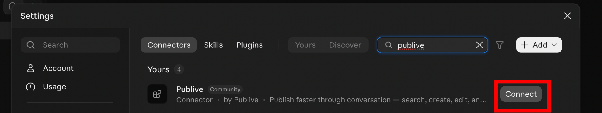
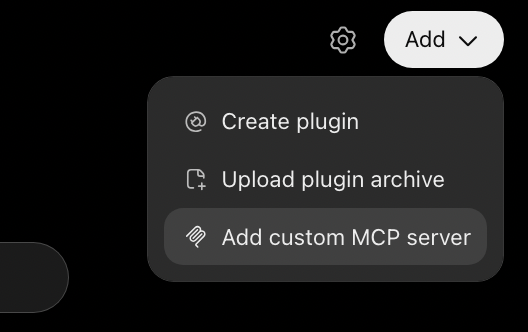
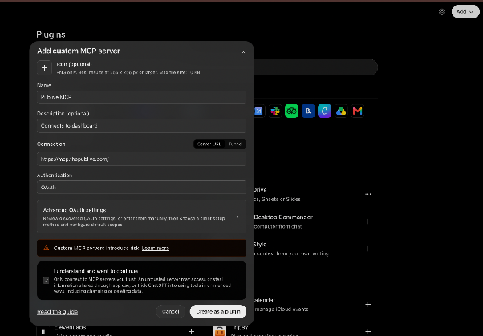
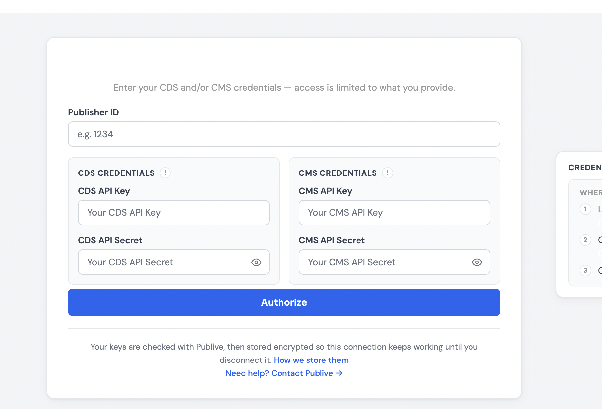
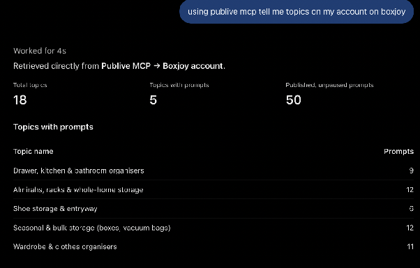

The Publive MCP server connects an AI assistant to your Publive workspace. After you connect it, you can ask Claude or ChatGPT about your AXP data in plain language. For example, ask for your topics, your brand visibility, or the sources that AI platforms cite.

MCP (Model Context Protocol) is an open standard. It lets an AI assistant use tools and data from another service.

The connection has two parts:

1. Add the Publive MCP server in Claude or in ChatGPT.
2. Sign in to Publive with your Publisher ID and API credentials.

## Prerequisites

- A Claude or ChatGPT account that can add connectors.
- Your Publisher ID, and your CDS credentials, CMS credentials, or both. Each set has an API key and an API secret. To get them, contact [support@thepublive.com](mailto:support@thepublive.com).

## Add the Publive MCP server

<Tabs>
  <Tab title="Claude">
    <Steps>
      <Step title="Open connectors">
        In Claude, go to **Settings** → **Customize** → **Connectors**.
      </Step>
      <Step title="Find Publive">
        Search for **Publive**. Next to **Publive**, click **Connect**.

        <Frame>
          
        </Frame>

        Claude opens the Publive sign-in page. Go to [Sign in to Publive](#sign-in-to-publive).
      </Step>
    </Steps>
  </Tab>
  <Tab title="ChatGPT">
    <Steps>
      <Step title="Open the custom MCP server form">
        In ChatGPT, go to **Settings** → **Plugins** → **Browser**. Click **Add**, and then click **Add Custom MCP server**.

        <Frame>
          
        </Frame>
      </Step>
      <Step title="Enter the server details">
        In the form:

        1. In **Name**, enter a name, for example `Publive MCP`.
        2. In **Connection**, enter this URL:

           ```text
           https://mcp.thepublive.com/mcp
           ```

        3. In **Authentication**, keep **OAuth**.
        4. Select the **I understand** check box.

        <Frame>
          
        </Frame>
      </Step>
      <Step title="Create the plugin">
        Click **Create as a Plugin**. Then click **Connect**.

        ChatGPT opens the Publive sign-in page. Go to [Sign in to Publive](#sign-in-to-publive).
      </Step>
    </Steps>
  </Tab>
</Tabs>

## Sign in to Publive

Claude and ChatGPT open the same Publive sign-in page.

1. In **Publisher ID**, enter your Publisher ID.
2. Enter your credentials:
   - In **CDS Credentials**, enter the **CDS API Key** and the **CDS API Secret**.
   - In **CMS Credentials**, enter the **CMS API Key** and the **CMS API Secret**.
3. Click **Authorize**.

<Frame>
  
</Frame>

You can enter the CDS credentials, the CMS credentials, or both. The AI assistant can use only the access that the credentials you enter give.

Publive checks your credentials and stores them encrypted. The connection continues to work until you disconnect it.

<Warning>
  The CMS credentials can read and change your content. Enter them only in an AI assistant account that you control.
</Warning>

When the connection is complete, go back to your AI assistant.

## Ask about your data

Ask your questions in plain language. The AI assistant reads the data from your Publive workspace and writes the answer. Examples:

- "Using Publive MCP, list the topics in my account."
- "What is my brand visibility for the last 30 days? Compare it with my top competitor."
- "Which of my tracked prompts do not mention my brand?"
- "Which domains do AI platforms cite most for my Home Loans topic?"

This example shows an answer about the topics in a demo account:

<Frame>
  
</Frame>

<Tip>
  Name the topic, the AI platform, and the date range in your question. Then you can compare the answer with the same view in the AXP dashboard.
</Tip>

<Note>
  The AI assistant writes its answer from your data, but it can make mistakes. Before you share a number or act on it, compare it with the AXP dashboard.
</Note>

## Next steps

<CardGroup cols={2}>
  <Card title="Build an AI visibility action report" icon="file-spreadsheet" href="/axp/guides/ai-visibility-action-report">
    Use the master prompt to turn your MCP data into an action plan for one topic.
  </Card>
  <Card title="Improve your AI visibility" icon="arrows-rotate" href="/axp/guides/improve-ai-visibility">
    The full cycle: choose topics, track prompts, act, and measure.
  </Card>
  <Card title="Brand Visibility" icon="chart-line" href="/axp/monitor/brand-visibility">
    The same data in the AXP dashboard.
  </Card>
  <Card title="Metrics and fields" icon="book" href="/axp/monitor/metrics">
    How AXP calculates each metric.
  </Card>
</CardGroup>
