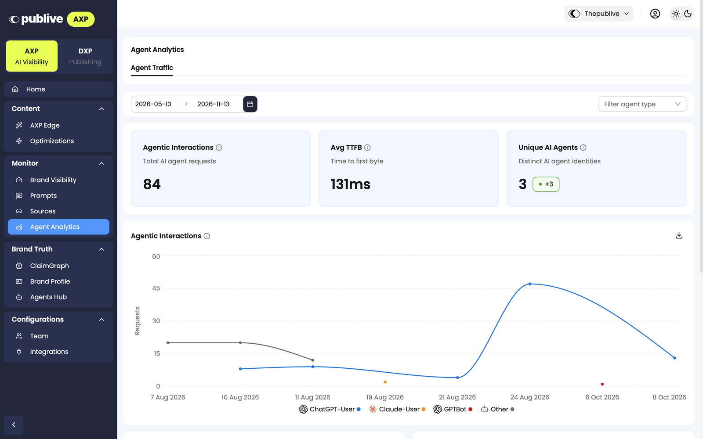

**Agent Analytics** shows the AI agent traffic to your domain. It is in the **Monitor** group of the AXP dashboard sidebar. The page has one tab: **Agent Traffic**.

<Frame>
  
</Frame>

## Filters

- **Date range:** The default range is the last 6 months.
- **Filter agent type:** Show the data for one AI agent, for example `GPTBot` or `ClaudeBot`.

## Headline metrics

| Card | What it shows |
|---|---|
| **Agentic Interactions** | The total number of requests from AI agents |
| **Avg TTFB** | The average time to first byte. This is the time that your pages take to start to respond to an AI agent. |
| **Unique AI Agents** | The number of different AI agent identities that visited your pages |

## Agentic Interactions chart

The chart shows the AI agent requests over time. Each line is one AI agent, for example **ChatGPT-User**, **PerplexityBot**, or **GPTBot**. Click **Download chart** to download the chart.

## Top Movers and Bottom Movers

- **Top Movers** shows the URLs with the largest increase in AI agent traffic in the date range.
- **Bottom Movers** shows the URLs with the largest decrease in AI agent traffic in the date range.

## URL Performance Analysis

This table shows each URL on your domain with its AI agent traffic.

| Column | What it shows |
|---|---|
| **URL Path** | The path of the page |
| **Agentic Hits** | The number of AI agent requests for the page |
| **Average TTFB** | How fast the page starts to respond to AI agents, for example **Fast** |
| **Most Hits By** | The AI agents that request the page most |

- To find a page, use **Search by URL**.
- To filter the list by URL path, click **Filter**. You can add more than one filter.
- To copy the URL of a page, click the copy icon.

## Next steps

<CardGroup cols={2}>
  <Card title="AXP Edge dashboard" icon="gauge" href="/axp/axp-edge/dashboard">
    See which pages AXP Edge optimizes, and set rules for AI agents.
  </Card>
  <Card title="Brand Visibility" icon="eye" href="/axp/monitor/brand-visibility">
    See how often AI assistants mention your brand.
  </Card>
</CardGroup>
