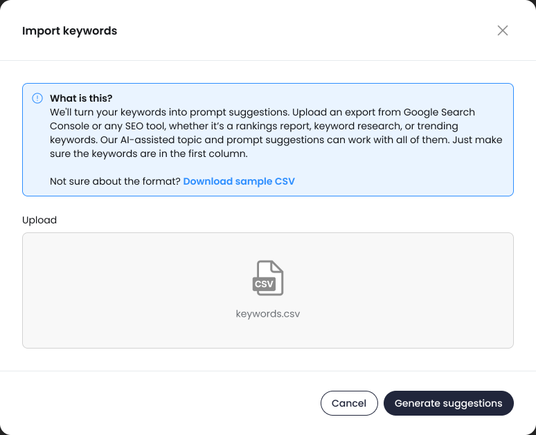

AXP proposes prompts that are worth tracking, so you are not limited to the prompts that you think of yourself. Suggestions are on the **Suggested** tab of the **Prompts** page. A suggestion does not run, and it does not count toward your [prompt limit](/axp/monitor/track-prompts#prompt-limit), until you accept it.

## Prerequisites

- Your [Brand Profile](/axp/axp-edge/dashboard#brand-profile) has your domains, products, category, location, and competitors. AXP uses these values to write suggestions.
- To get suggestions for a page, the page must be in the **All URLs** table of [AXP Edge](/axp/axp-edge/overview).

## Where suggestions come from

| Source | How AXP finds the prompt |
|---|---|
| Your topics | For each topic, AXP finds search keywords that relate to the topic. It also finds keywords that your domain already ranks for. AXP then writes prompts for the types of question that the topic does not cover yet. |
| Your products | AXP writes specific questions about the products in your Brand Profile, for example questions about eligibility or a use case. At least 30% of the suggestions for a topic are of this type. |
| Keyword import | You upload a list of keywords. AXP writes prompts from them. Refer to [Import keywords](#import-keywords). |
| One of your pages | You select a page in AXP Edge. AXP writes prompts that the page can answer. Refer to [Suggest prompts for a page](#suggest-prompts-for-a-page). |

AXP uses your Brand Profile for all sources: your brand name, category, location, products, and competitors. All suggestions go to the same list on the **Suggested** tab, grouped by topic.

<Accordion title="How AXP checks suggestions">
  AXP shows a suggestion only if it passes these checks:

  - It reads like a question that a person types into an AI assistant. A string of keywords does not pass.
  - It is on the topic, and it fits your category and location.
  - It mentions only brands, products, and places that AXP knows from your Brand Profile and keywords.
  - It does not contain numbers, prices, rates, or rankings that are not in the keyword.
  - It is not the same as, or very similar to, a prompt that you track, paused, or have waiting on the **Suggested** tab.
  - It is not similar to suggestions that you rejected before.

  A second AI model reviews each suggestion before AXP shows it.
</Accordion>

At least 70% of the suggestions do not mention your brand. Prompts that do not mention your brand show if AI assistants find you when buyers ask in general.

## What each suggestion shows

| Column | What it shows |
|---|---|
| **Prompts** | The prompt text |
| **Topic** | The topic that the prompt goes into when you accept it |
| **Volume** | The estimated search volume for the prompt. It shows "–" when no estimate is available. |
| **Branding** | **Branded** if the prompt text mentions your brand. **Non branded** if it does not. |
| **Intent** | **Informational**, **Commercial**, or **Transactional** |
| **Suggested at** | The date and time of the run that made the suggestion |
| **Actions** | The icons to accept or reject the suggestion. Hover over an icon to see its label. |

To filter the list, click **Filters**. You can filter suggestions by **Topic**, **Branding**, and **Intent**.

## Accept suggestions

When you accept a suggestion, it moves to the **Tracking** tab and AXP starts to run it.

- To accept one suggestion, click the accept icon in the **Actions** column.
- To accept many suggestions, select their rows. Then use the bulk accept action. AXP reports the result for each row.

Each accepted suggestion counts toward your prompt limit. You cannot accept a suggestion when you are at the limit. The dashboard shows a message that you reached the prompt limit. In a bulk accept, AXP accepts suggestions until you reach the limit. It marks each remaining row as over the limit.

## Reject a suggestion

In the **Actions** column, click the delete icon. A dialog asks you to approve the rejection. When you approve it, AXP deletes the suggestion from the list. AXP does not suggest similar prompts again.

## Suggest more

Click **Suggest more** to get new suggestions. AXP makes the suggestions in the background. They show on the **Suggested** tab after 2 to 3 minutes.

- The **Suggested** tab holds up to 25 suggestions that wait for review.
- Each run adds up to 5 new suggestions for each topic.
- A run stops when 25 suggestions wait for review. For example, if 10 suggestions wait, a run adds up to 15 new suggestions.
- Suggestions from different runs stay on the tab together. A run does not replace the suggestions that you did not review yet.
- When 25 suggestions wait for review, AXP makes no more. Accept or delete some suggestions first.
- You can run **Suggest more** up to 25 times a day.
- AXP uses what it knows about your brand now. It does not repeat the suggestions that it made before.

These numbers are maximums, not targets. AXP shows a suggestion only if it is useful. If AXP cannot find enough useful prompts, it shows fewer suggestions. It does not add weak prompts to fill the list.

### Messages

| Message | When it shows |
|---|---|
| Generating suggestions. This takes 2-3 minutes; they will appear in the Suggested tab. | AXP started the run. |
| Suggestions are already being generated. They will appear in the Suggested tab. | You clicked **Suggest more** while a run was in progress. |
| 25 suggestions are already waiting for review. Approve or delete some to get more. | The **Suggested** tab is full. |
| Suggestion limit reached for today, try again tomorrow. | You used all the runs for today. |
| Prompt suggestions are temporarily unavailable. Please try again later. | AXP cannot make suggestions now. |
| Prompt suggestions are not enabled for this publisher. | Prompt suggestions are off for your account. Contact Publive to turn them on. |

## Import keywords

<Note>
  Keyword import is in testing. It is possible that your dashboard does not show it yet.
</Note>

Upload a keyword list to get suggestions that come from your own search data. You can upload an export from Google Search Console or from an SEO tool, for example a rankings report, keyword research, or trending keywords.

<Frame>
  
</Frame>

<Steps>
  <Step title="Open the import">
    On the **Suggested** tab, click **Import keywords**.
  </Step>
  <Step title="Upload the file">
    In the **Import keywords** dialog, upload a CSV file with the keywords in the first column. To see the format, click **Download sample CSV**.
  </Step>
  <Step title="Generate the suggestions">
    Click **Generate suggestions**. This button is available after you upload a file.
  </Step>
  <Step title="Review the suggestions">
    AXP adds the new suggestions to the **Suggested** tab after 2 to 3 minutes. Accept or reject each one.
  </Step>
</Steps>

Keywords make suggestions, not tracked prompts. You decide which suggestions to accept.

- The file must be a CSV file.
- A file can have up to 200 keywords. This limit can change.
- AXP tries to make suggestions for as many keywords as it can. It does not tell you which keywords got no suggestion.
- The limits of [Suggest more](#suggest-more) also apply to a keyword import, for example the limit of 25 suggestions that wait for review.

| Message | When it shows |
|---|---|
| The uploaded keywords file could not be found. Upload it again. | AXP cannot read the file that you uploaded. |
| The uploaded keywords file is empty. | The file has no content. |

## Suggest prompts for a page

You can get suggestions for one page that you want AI assistants to cite more often.

1. In AXP Edge, open **Content**.
2. In the **All URLs** table, find the page.
3. In the **Actions** column, open the menu and click **Suggest prompts for this URL**.

AXP reads the page and the keywords that it ranks for. It then proposes up to 10 prompts that the page can answer. The **Prompt suggestions for this URL** dialog shows the suggestions and your prompt limit.

- To track suggestions, select them. Then click **Start tracking**. **Start tracking** is not available until you select at least one suggestion.
- To get new suggestions for the page, click **Refresh suggestions**.

The suggestions also go to the same list on the **Suggested** tab.

AXP must be able to read the text of the page. If the page builds its content only in the browser, AXP cannot read enough text, and it cannot suggest prompts for the page.

## Next steps

<CardGroup cols={2}>
  <Card title="Track prompts" icon="list-check" href="/axp/monitor/track-prompts">
    Manage the prompts that you accepted.
  </Card>
  <Card title="AXP Edge dashboard" icon="bolt" href="/axp/axp-edge/dashboard">
    Find the Content page and the All URLs table.
  </Card>
</CardGroup>
