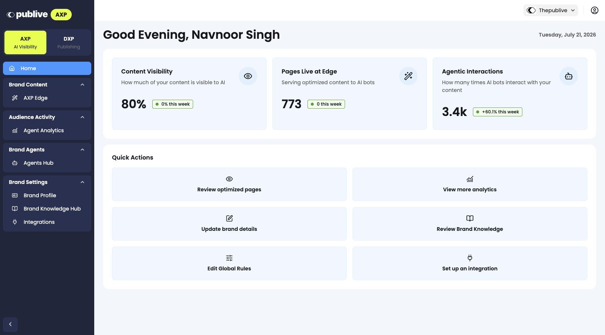

Publive AXP (Agent Experience Platform) makes your brand findable and citable inside AI answers from ChatGPT, Google AI Overviews, Perplexity, and Gemini. AI agents read your site the same way human visitors and search crawlers do. If they can't parse or trust your content, they won't cite it.

<Card title="Go to the AXP dashboard" icon="gauge" href="https://dashboard.thepublive.com/v2/axp" horizontal>
  Manage your Brand Profile, AXP Edge rules, optimizations, and Agent Analytics.
</Card>

<Frame>
  
</Frame>

Publive AXP has four products:

<CardGroup cols={2}>
  <Card title="AXP Edge" icon="bolt" href="/axp/axp-edge/overview">
    Makes the pages you already have readable to AI, with no rebuild.
  </Card>
  <Card title="Brand AI Observability" icon="eye" href="/axp/monitor/overview">
    Tracks how AI assistants answer the prompts your buyers ask, and how your brand compares with competitors.
  </Card>
  <Card title="AI Streams" icon="sparkles">
    Publishes new, AI-first content designed to be cited. **Coming soon.**
  </Card>
  <Card title="AXP ClaimGraph" icon="diagram-project">
    Builds the official record of what your brand claims, and finds pages and AI answers that disagree with it. **Coming soon.**
  </Card>
</CardGroup>

## AXP Edge vs. AI Streams

AXP Edge and AI Streams both change what AI agents can read about you, but in different ways. You can run one or both.

| | AXP Edge | AI Streams |
|---|---|---|
| What it does | Serves your existing pages to AI, clean and structured | Builds new AI-first content on your domain |
| Effort | Plug and play at the CDN layer, no rebuild | Managed by Publive AXP's content engine |
| New content? | No, it re-renders what you already have | Yes, prompt-researched pages published to a `/streams` section |
| Learn more | [AXP Edge overview](/axp/axp-edge/overview) | Coming soon |

<Info>
  Both products leave your site untouched for human visitors and search crawlers. Only AI agents receive a different, optimized response.
</Info>

## Use cases

| Use case | Product | How |
|---|---|---|
| Make your existing site AI-citable without a rebuild | AXP Edge | Turn it on at the CDN layer. It's live in under two hours, with no code changes. |
| Keep your current SEO unaffected while adding AI visibility | AXP Edge | Human visitors and search crawlers see your site unchanged. Only AI agents get the optimized view. |
| See which AI platforms are crawling your site | AXP Edge | [Agent Analytics](/axp/axp-edge/agent-analytics) breaks down agent traffic by agent, including GPTBot and PerplexityBot. |
| Keep specific pages out of the AI view | AXP Edge | Add [URL pattern overrides](/axp/axp-edge/dashboard#url-pattern-overrides) to exclude pages or sections from optimization. |
| Win the queries your competitors currently answer | AI Streams | Publish schema-rich pages targeted at the prompts your buyers ask AI. |
| Add AI-first content without restructuring your site | AI Streams | Pages publish to a `/streams` subdirectory on your domain. No migration is required. |
| Track how AI describes your brand over time | Brand AI Observability | [Track prompts](/axp/monitor/overview) and see visibility, share of voice, sentiment, and citations against competitors. Walkthrough: [Benchmark your brand against competitors](/axp/guides/benchmark-brand-against-competitors). |
| Find the pages that AI cites in your market | Brand AI Observability | [Sources](/axp/monitor/sources) shows the cited domains and pages, and if they mention you. Walkthrough: [Close citation gaps](/axp/guides/close-citation-gaps). |
| Check your AI readiness before you commit | Audit Hub | Run the free [Content Visibility Grader and Brand AI Readiness Analyzer](/axp/audit-hub/overview). |

## Who it's for

Publive AXP is for the teams that make web properties AI-readable and citable, and the teams that measure how AI represents the brand:

| Team / role | Technical focus |
|---|---|
| Engineering & DevOps | Deploy AI-first SSR rendering and CDN-layer routing without altering application code or origin infrastructure. |
| Technical SEO & GEO leads | Ensure clean JSON-LD, structured schema, and bot user-agent management for generative engine optimization. |
| Content & Platform leads | Serve token-optimized content directly to AI agents while maintaining existing brand design for human visitors. |
| Marketing & brand teams | Track how AI assistants answer buyer questions, benchmark the brand against competitors, and find the sources that AI cites. |

## Supported architectures

| Site architecture | Integration approach |
|---|---|
| Decoupled & Headless | Edge middleware or CDN worker routing (Vercel, Cloudflare). Fastly is coming soon. |
| Server-Rendered / Monolithic | DNS-level edge proxy with zero origin code changes. |
| Multi-Domain / Enterprise | Centralized rule management across multiple brand properties. |

## Next steps

<CardGroup cols={2}>
  <Card title="Getting started" icon="bolt" href="/axp/axp-edge/setup">
    Get your existing site readable to AI in under two hours.
  </Card>
  <Card title="Brand AI Observability" icon="eye" href="/axp/monitor/overview">
    Track the prompts your buyers ask AI, and see how your brand compares with competitors.
  </Card>
  <Card title="Use-case guides" icon="route" href="/axp/guides/benchmark-brand-against-competitors">
    Step-by-step walkthroughs for a goal, for example benchmarking your brand against competitors.
  </Card>
  <Card title="Try the Audit Hub" icon="magnifying-glass" href="/axp/audit-hub/overview">
    Free tools to see what AI agents can currently read and cite from your site.
  </Card>
  <Card title="Get in touch" icon="comments" href="https://axp.thepublive.com/contact">
    Talk to Publive about getting AXP Edge live on your domain, or any other AXP question.
  </Card>
</CardGroup>
