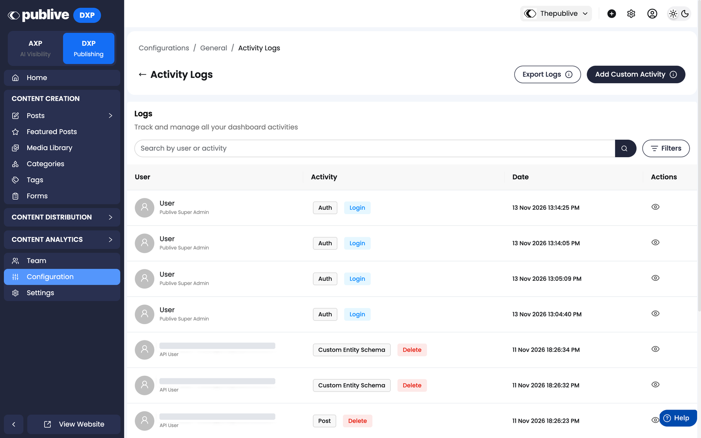

import CustomEnterprise from '/snippets/availability/custom-enterprise.mdx';

Audit Logs record all key dashboard actions with the acting member and a timestamp, giving you a complete activity trail across your workspace.

<Frame>
  
</Frame>

## Availability

<CustomEnterprise />

## What's logged

Each log entry records the **acting member** and a **timestamp**.

### Phase 1 — Content operations, team management, configuration

Tracked from **April 28, 2026**:

| Category | Actions tracked |
|----------|----------------|
| Content operations | Create, update, publish, and delete actions on content |
| Team management | Changes to team members and roles |
| Configuration | Changes to workspace settings and configuration |

### Phase 2 — Post-level events

Tracked from **May 19, 2026**:

| Event | Description |
|-------|-------------|
| Publish | A post is published |
| Unpublish | A post is unpublished |
| Schedule | A post is scheduled for future publication |
| Delete | A post is deleted |

### Workflow events

Tracked from the release of [Content Workflows](/dxp/documentation/content-workflows/overview) for content types that use a workflow:

| Event | Description |
|-------|-------------|
| Stage change | An entry is moved from one stage to another, with the acting member, their role at the time, and any note |
| Override | An entry is moved to a stage by an override actor, with the required reason |

See [Notifications and audit trail](/dxp/documentation/content-workflows/notifications-and-audit-trail) for what each record contains.

## Accessing audit logs

The **Audit Logs** view is available in the Publive dashboard under your workspace settings. To enable it, contact [support@thepublive.com](mailto:support@thepublive.com).
