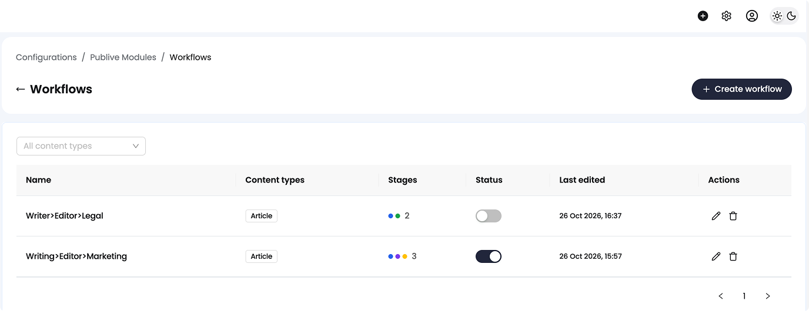
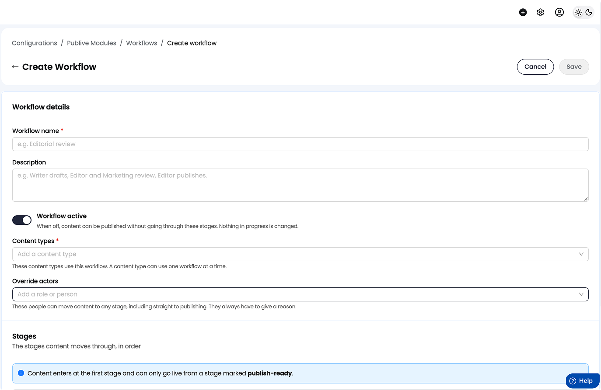
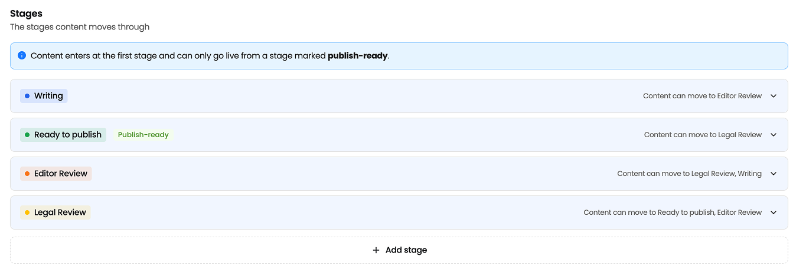
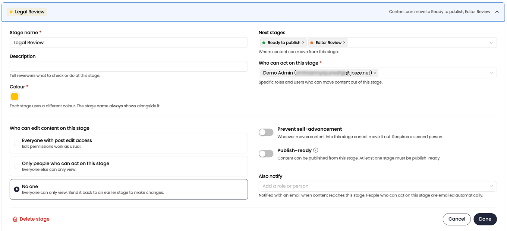
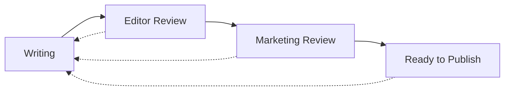

Build a workflow once, assign it to one or more content types, and every new entry of those types moves through your stages.

## Prerequisites

- Content Workflows is enabled for your account. See the [overview](/dxp/documentation/content-workflows/overview).
- You are an **Admin**, an **Owner**, or hold a role with workflow configuration permission.
- Any reviewer role your stages need already exists, for example **Marketing Reviewer**. A workflow never creates roles of its own. It references the roles and members you already have. See [Content Access Policies](/dxp/documentation/concepts-features/content-access-policies) for how roles are set up.

## Where to find it

There are two entry points, and both show the same assignment:

- **Configuration → Workflows** to build and manage your workflows.
- **Content type settings**, where the **Workflow** row shows which workflow applies to that content type, with a link into the editor.

## The workflow list

The list shows each workflow's **Name**, **Content types** (as chips), **Stages** (a count, shown as colored dots), a **Status** toggle to turn the workflow on or off, and **Last edited**. A content type filter above the list narrows it down. From here you can **Create workflow**, open a workflow to edit it, or delete it.

<Frame>
  
</Frame>

If you have no workflows yet, the page explains what a workflow is and offers a starter template, **Draft → Review → Ready to Publish**. The template is a normal workflow that you can edit freely.

## Create a workflow

<Steps>
  <Step title="Enter the details">
    Give the workflow a **Workflow name** (required, unique in your workspace) and an optional **Description**. Use the **Workflow active** toggle to turn it on or off. When it's off, content publishes without going through these stages, and nothing already in progress changes.
  </Step>
  <Step title="Choose the content types">
    Pick one or more content types for this workflow to apply to. This field is required. System and custom content types are both available. A content type can use only one workflow at a time. If a content type you add already uses another workflow, that workflow's name is shown and the content type cannot be added until it is released from it.
  </Step>
  <Step title="Add override actors (optional)">
    **Admins** and **Owners** are always override actors for this workflow and cannot be removed. Use this step to name more, such as one or more roles, one or more members, or a mix of both, who can also move content to any stage, including straight to publishing. Overriders always have to give a reason. See [Override](/dxp/documentation/content-workflows/review-and-move-content#override-a-stage). You can leave this step empty and rely on Admins and Owners alone.
  </Step>
  <Step title="Build the stages">
    Add, duplicate, delete, and drag to reorder stages. Each row shows the stage colour, name, a publish-ready marker, and a summary of who can act. Select a row to open the stage editor.
  </Step>
  <Step title="Save">
    Fix anything that blocks saving. See [Validation](#validation).
  </Step>
</Steps>

<Frame>
  
</Frame>

A workflow has at least **2** and at most **20** stages. The first stage is where every new entry starts.

<Frame>
  
</Frame>

## Stage settings

<Frame>
  
</Frame>

| Field | What it does |
|---|---|
| **Stage name** | Required. Must be unique within the workflow. |
| **Description** | Optional. Shown to reviewers as a hint about what to check or do at this stage. |
| **Colour** | Required. Must be unique within the workflow. Chosen from a fixed palette. |
| **Publish-ready** | When on, content in this stage may go live. At least one stage must be publish-ready. |
| **Next stages** | Where content can move from this stage. Selecting none makes the stage a dead end, and the editor warns you. |
| **Who can act on this stage** | One or more roles, one or more members, or a mix of both, who can move content out of this stage. At least one is required unless the stage is a dead end. |
| **Who can edit content on this stage** | **Everyone with post edit access**, **Only people who can act on this stage**, or **No one**. **No one** is a hard freeze: everyone can only view, and content must be moved to another stage to be changed. |
| **Prevent self-advancement** | Off by default. When on, whoever moves content into this stage cannot move it out. Requires a second person. |
| **Also notify** | Optional. One or more roles, one or more members, or a mix of both, notified by email when content reaches this stage. People who can act on this stage are emailed automatically, so this is for anyone else who should know. |

<Note>
**Who can edit** only restricts. It never gives edit access to a member who would not otherwise have it.
</Note>

### Prevent self-advancement

Switch **Prevent self-advancement** on for every review stage and no single member can walk content from draft to live. It also stops authors approving their own work: the author moves their entry out of the first stage, so with the rule on at the first review stage, they cannot also move it out of that stage.

There is no separate "author cannot act on their own content" setting. This one rule covers it.

## Validation

These block saving:

| Rule | Message |
|---|---|
| Too few stages | A workflow needs at least two stages. |
| Too many stages | A workflow can have at most 20 stages. |
| No publish-ready stage | At least one stage must be marked publish-ready, or content in this workflow can never go live. |
| Duplicate stage name | Another stage is already called the same name. |
| Duplicate stage colour | The colour is already used by another stage. |
| No actors | Nobody can move content out of the stage. |

The editor also warns, without blocking, when:

- a stage cannot be reached from any other stage. The first stage is exempt, and a stage that is only ever entered by override is legitimate.
- a stage's actors resolve to no active member, so content that reaches it will be stuck.

## Example: a four-stage editorial workflow

Applies to the Article, Video, and Photo Gallery content types.

| Stage | Next stages | Who can act | Who can edit | Prevent self-advancement | Publish-ready |
|---|---|---|---|---|---|
| **Writing** | Editor Review | Content Writer, Editor | Everyone with post edit access | Off | No |
| **Editor Review** | Marketing Review, Writing | Editor | Only people who can act on this stage | On | No |
| **Marketing Review** | Ready to Publish, Writing | Marketing Reviewer | No one | On | No |
| **Ready to Publish** | Writing | Editor | No one | Off | Yes |

Override actors: Admin and Owner, by default. No further actors added.

A writer drafts in **Writing** and moves the entry to **Editor Review**. An editor reviews it and moves it to **Marketing Review**. A Marketing Reviewer approves it to **Ready to Publish**. An editor then publishes it.

Suppose one member holds both the Editor and Marketing Reviewer roles. **Prevent self-advancement** still stops them moving the entry out of **Marketing Review** right after they moved it in. Approval and release stay separate acts by different people.

## Edit a workflow that is in use

Changes take effect immediately for all content in the workflow. There are no per-entry versions of the rules.

**Deleting a stage.** The confirmation tells you how many entries are in the stage. Those entries return to the first stage, and their history is kept.

**Turning a workflow off.** The confirmation lists how many entries are in review. Turning it off:

- changes no statuses
- publishes nothing
- returns nothing to Draft
- returns publishing to normal permissions
- keeps stage history

**Deleting a workflow.** You cannot delete a workflow that is assigned to a content type. The dialog names the content type so you can release it first.

## Next steps

<CardGroup cols={2}>
  <Card title="Review and move content" href="/dxp/documentation/content-workflows/review-and-move-content">
    See how members move entries through the stages you built.
  </Card>
  <Card title="Lifecycle and edge cases" href="/dxp/documentation/content-workflows/lifecycle-and-edge-cases">
    What happens when live content is edited, a stage is deleted, or two members act at once.
  </Card>
</CardGroup>
