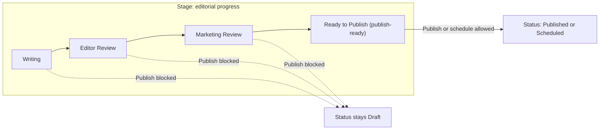

import CustomEnterprise from '/snippets/availability/custom-enterprise.mdx';

A **workflow** is a named, ordered set of review stages that content moves through before it can be published. You build each workflow yourself and assign it to one or more content types. For every stage, you decide who can move content to its next stages and who can edit it. You also decide whether it is the stage that means "ready to go live".

## Availability

<CustomEnterprise />

Content Workflows is turned on per workspace. Until it's on, you see no new columns, filters, panels, or settings, and publishing works exactly as it does today.

<Note>
Workflow configuration and review actions are designed for the desktop dashboard.
</Note>

## Why use workflows

A workflow models the review process your team already follows, for example writer, then editor, then compliance, then publish. The gate it creates is enforced, not advisory. Content cannot be published or scheduled from the dashboard until it reaches a stage you have marked **publish-ready**. Holding publish permission is no longer enough on its own.

The member who approves content does not have to be the member who publishes it. Every stage change is attributed to a member and kept in the entry's timeline and in your [Audit Logs](/dxp/documentation/concepts-features/audit-logs).

## Core concepts

| Concept | What it is |
|---|---|
| **Workflow** | A named, reusable review process. It can apply to one or more content types, each of which can use only one workflow at a time. It has an ordered list of stages and a set of override actors, which always includes Admins and Owners. |
| **Stage** | A named, colored position in the workflow, such as **Editor Review**. Each stage controls where content can go next, who can move it, who can edit it, and whether it can go live. |
| **Transition** | Moving an entry from one stage to another. A move needs the destination to be one of the current stage's **Next stages**. You must be listed in **Who can act**. And **Prevent self-advancement** must not block you. |
| **Publish-ready stage** | A stage from which content is allowed to go live. A workflow needs at least one. |
| **Assignee** | An optional metadata field that shows which member is expected to review an entry. It is for visibility only and has no effect on permissions: anyone who is eligible at the stage can still act. |
| **Prevent self-advancement** | A per-stage rule. The member who moved an entry into the stage cannot move it out again, so a second person is required. |
| **Override** | An escape hatch. **Admins** and **Owners** are always override actors for every workflow and cannot be removed from that role. A workflow can also name more roles or members as override actors. Any override actor can move an entry to any stage, with a required reason that is recorded separately. |

A transition can carry an optional **note**. It's the place to tell the next reviewer, or the author if the entry is heading back to them, what they should know. A workflow has no fixed forward or backward path: a stage's **Next stages** can point to any other stage. Every move uses the same note, optional every time.

## Stage and status are separate

Every entry already has a **status**: Draft, Scheduled, or Published. Status answers where an entry is in its publishing lifecycle.

A workflow adds a second, independent dimension: **stage**. Stage answers where an entry is in your editorial process. An entry always has both.

The two meet in one place:

> An entry can become **Scheduled** or **Published** only while its stage is publish-ready.

Everything else about status is unchanged. Unpublishing, scheduling, and the live version being served separately from your working copy all work as before.

For content types that use a workflow, the **Approval Pending** status is not used. An entry in review is a Draft in a review stage.

| Status | Stage | What it means | Can it be published now? |
|---|---|---|---|
| Draft | Writing | Being written, never published | No, the stage is not publish-ready |
| Draft | Editor Review | Awaiting first review, never published | No |
| Draft | Ready to Publish | Approved, waiting for someone to release it | **Yes** |
| Draft | Editor Review, with a live version | Live content with an edit in review. The live version keeps serving. | No, the update cannot go out yet |
| Published | Ready to Publish | Live, no pending edits | Already live. It can be updated. |

When the gate blocks publishing, the **Publish** control stays visible but disabled. It tells the author which stage the entry must reach and which stage it is in now. It is never silently hidden.

<Warning>
The stage gate applies to publishing from the Publive DXP dashboard. Content that arrives through the CMS API, ingestion feeds, syndication, or form (UGC) approval is not checked against workflow stages in this release.
</Warning>

## Who can do what

| Action | Who |
|---|---|
| Create, edit, and delete workflows, and assign them to content types | Admins, Owners, and any role granted workflow configuration permission |
| Move an entry between stages | Members listed in the current stage's **Who can act**, subject to **Prevent self-advancement** |
| Edit an entry | Members with normal edit permission, narrowed by the stage's **Who can edit** setting |
| Override | Admins, Owners, and any other override actors the workflow names |
| Publish or schedule | Members with publish permission, and only while the entry is in a publish-ready stage |
| View the timeline | Anyone who can view the entry |

Workflow rules **narrow** the permissions your roles already grant. They never widen them. Being named in a stage lets you move the entry from that stage and nothing more. It does not give you access to edit or publish.

A stage also never changes who can **see** an entry. Visibility is decided only by your existing [Content Access Policies](/dxp/documentation/concepts-features/content-access-policies).

## How it fits with Send for Approval

Workflows is opt-in at two levels:

1. **Per workspace.** Content Workflows must be enabled.
2. **Per content type.** A content type is governed only once a workflow is assigned to it.

In a workspace with Workflows enabled, a content type that has a workflow uses stages and the publish gate. A content type without one keeps the existing **Send for Approval** and **Pending Approval** flow, unchanged. Both models run side by side. You can pilot a workflow on one content type, for example Articles, and leave the rest alone.

For the status-based flow, see [Maker-Checker Workflow](/dxp/documentation/guides/workflows/maker-checker).

## Next steps

<CardGroup cols={2}>
  <Card title="Configure workflows" href="/dxp/documentation/content-workflows/configure-workflows">
    Build stages, set who can act, and assign a workflow to a content type.
  </Card>
  <Card title="Review and move content" href="/dxp/documentation/content-workflows/review-and-move-content">
    Move entries between stages, override a stage, and read the timeline.
  </Card>
</CardGroup>
