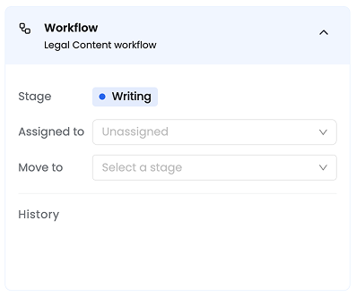
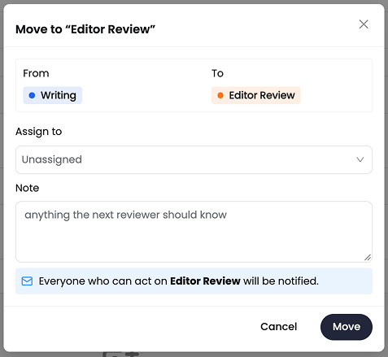
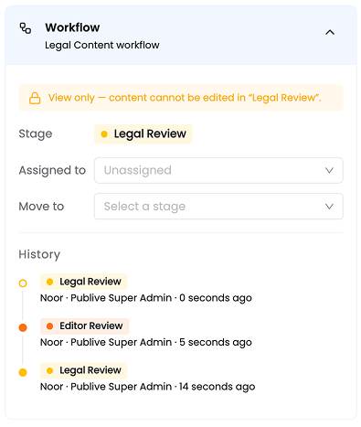

Once a workflow is assigned to a content type, every entry of that type has a stage. This page covers what authors and reviewers see and do.

<Note>
New entries start in the workflow's first stage the moment they are created. There is no separate submit action.
</Note>

## The content list

For content types with a workflow, the content list gains:

- a **Stage** column showing the stage name on its stage colour
- a **Stage** filter to pick one or more stages. In a view that spans several workflows, stages are grouped under their workflow name.
- an **Assignee** filter, with **Assigned to me** as the first option

Status tabs, columns, search, and existing filters are unchanged. Content types without a workflow show no **Stage** column.

<Tip>
**Assigned to me** plus a stage filter is the quickest way for a reviewer to find their work. Save the combination as a filter view to get back to it in one click.
</Tip>

## The workflow panel

Open an entry and look for the **Workflow** panel in the right-hand sidebar. It shows:

| Item | What it shows |
|---|---|
| **Workflow** | The name of the workflow that applies |
| **Stage** | The current stage on its colour. You cannot change it directly. Moving is a deliberate action. |
| **Assigned to** | The current assignee, or **Unassigned** |
| **Move to** | A picker of the stages you can move this entry to right now |
| **History** | The entry's timeline |

For content types without a workflow, the panel does not appear at all.

<Frame>
  
</Frame>

## Move an entry

<Steps>
  <Step title="Choose a destination">
    Open **Move to** and pick a stage. It lists only the stages you are allowed to move to.
  </Step>
  <Step title="Assign to (optional)">
    Set who should pick this up at the new stage. It defaults to **Unassigned**. You can also skip this and assign it later from the panel.
  </Step>
  <Step title="Add a note (optional)">
    The dialog also shows who will be notified.
  </Step>
  <Step title="Confirm">
    Select **Move**. Selecting **Cancel** does nothing.
  </Step>
</Steps>

<Frame>
  
</Frame>

If you cannot move the entry anywhere, the picker is replaced by a line explaining why:

- Only the named roles or members can move this entry out of the stage.
- You moved this entry to the stage, so someone else must move it on. This applies when **Prevent self-advancement** is on.

### Send an entry back

Moving an entry to an earlier stage is a **send back**. The dialog changes to **Send back**. The note is optional here too, but it is the place to tell the author what to change.

## Override a stage

Override actors are set once for the whole workflow, not per stage. **Admins** and **Owners** are always override actors and cannot be removed from that role. A workflow can also name more roles or members as override actors in its settings. See [Add override actors](/dxp/documentation/content-workflows/configure-workflows#create-a-workflow).

Override actors see a separate, visibly distinct **Override stage** action. It is not an option in the **Move to** picker.

1. Choose any stage as the destination, including a publish-ready stage. The dialog lists the stages being skipped.
2. Enter a **reason**. The **Override** button stays disabled until you do.
3. Select **Override**.

An override ignores **Next stages**, **Who can act**, and **Prevent self-advancement**. It is recorded as an override, not a normal move, and the actors at each skipped stage are notified.

## Assign an entry

There are two ways to set the assignee:

- **While moving an entry.** The move dialog has an **Assign to** field, so you can hand the entry to someone the moment it reaches their stage.
- **From the panel, at any time.** Open **Assigned to** to set, change, or clear it. Setting an assignee emails them.

Once an entry is at a stage, only members who can act at that stage can change its assignee. This follows the same rule as everything else at a stage: **Who can act** decides who may touch it.

The assignee is a metadata field that shows who is expected to review the entry. It is for visibility only and does not affect permissions. Anyone who is eligible at the current stage can still act on the entry, whether or not they are the assignee.

## Editing an entry in a stage

The current stage's **Who can edit** setting applies on top of the permissions you already have. A stage can only restrict editing. It never grants it.

When the stage prevents you from editing, the entry opens read-only with a banner naming the stage, for example:

> View only — content cannot be edited in "Legal Review".

<Frame>
  
</Frame>

The existing concurrent-edit lock is unaffected. Two members still cannot edit at the same time, whatever the stage.

## Publishing from a stage

You can publish or schedule an entry only while it is in a publish-ready stage, and only if you have publish permission. Otherwise the **Publish** control is visible but disabled, and explains which stage the entry must reach and which stage it is in.

## The timeline

The **History** section of the panel lists every stage change, newest first. Each item shows:

- the stage moved to, on its colour
- who moved it, and their role at the time
- when
- the note, if there was one
- for an override, an **Override** marker, the reason, and the stages skipped
- for the first entry, who created it and when

Anyone who can view the entry can see its timeline, including authors who cannot act. Records are permanent. If a stage is later renamed or deleted, the timeline still names it as it was.

## Next steps

<CardGroup cols={2}>
  <Card title="Notifications and audit trail" href="/dxp/documentation/content-workflows/notifications-and-audit-trail">
    Who gets emailed for each event, and what is recorded.
  </Card>
  <Card title="Lifecycle and edge cases" href="/dxp/documentation/content-workflows/lifecycle-and-edge-cases">
    What happens when live content is edited or two members act at once.
  </Card>
</CardGroup>
