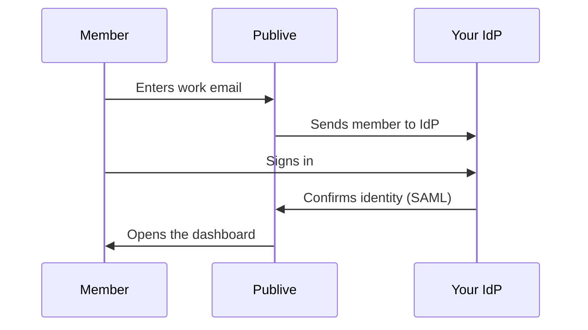

import CustomEnterprise from '/snippets/availability/custom-enterprise.mdx';

{/* Shared by Publive DXP and Publive AXP. Edit here, not in the product pages. */}

Single sign-on (SSO) lets your members sign in to the Publive dashboard with their company account. Your identity provider (IdP) confirms who they are. Publive then opens the dashboard for them.

SSO uses SAML 2.0. It works with Okta, Microsoft Entra ID, Google Workspace, Scalefusion OneIdP, and any other IdP that supports SAML 2.0.

## Availability

<CustomEnterprise />

## Prerequisites

- Your IdP supports SAML 2.0.
- A member of your IT team can create a SAML application in your IdP.
- Each member who uses SSO exists in your workspace with a role. See [Who can sign in](#who-can-sign-in).

## How members sign in

1. On the login page, the member clicks **Continue with SSO**.
2. The member enters their work email and clicks **Continue with SSO**.
3. Publive sends the member to your IdP.
4. The member signs in to your IdP.
5. Your IdP sends the member back, and the dashboard opens.

The member must complete the sign-in at the IdP within 5 minutes. If they take longer, they must start again.

## Set up SSO

Setup is a shared task between your IT team and Publive. You do not need to change any code.

1. Contact [support@thepublive.com](mailto:support@thepublive.com). Tell Publive your IdP and the email domains your members use (for example, `example.com`).
2. Publive sends you two values: the **ACS URL** and the **Entity ID**.
3. In your IdP, create a SAML application for Publive. Enter the ACS URL and the Entity ID.
4. Configure the attributes in the table below.
5. Assign the application to the members who need dashboard access.
6. Send Publive your IdP metadata URL. If your IdP does not supply one, send the IdP certificate, the IdP Entity ID, and the IdP SSO URL.
7. Publive tests a sign-in with you before SSO goes live for your members.

### SAML attributes

Your IdP sends these attributes for each member:

| Attribute | Required | Value |
| --- | --- | --- |
| `email` | Yes | The member's work email |
| `firstName` | Yes | The member's first name |
| `lastName` | No | The member's last name |

Publive reads the member ID from the SAML `NameID`. You do not need a separate attribute for it.

<Warning>
  If `email` or `firstName` is empty for a member, that member cannot sign in.
</Warning>

## Rollout stages

Publive turns on SSO in stages. Each stage gets a test sign-in before the next stage starts.

| Stage | What members see |
| --- | --- |
| **Testing** | No change. Publive and your IT team test the connection. |
| **Optional** | Members can sign in with SSO or with a password. |
| **Required** | Members must sign in with SSO. Password, Google, Microsoft, and Facebook sign-in stop working. |
| **Disabled** | SSO is off. Members sign in with a password again. |

<Tip>
  Keep your workspace on **Optional** for a few days. If a member account is missing, you find the problem before that member loses access.
</Tip>

<Warning>
  When your workspace moves to **Required**, Publive signs out every member who signed in with a password. Plan this change with your team, outside working hours if possible.
</Warning>

When SSO is **Required**, a member who tries to sign in with a password sees a message:

*Your email has an SSO set up, please continue with SSO.*

The login page then changes to SSO sign-in.

## Who can sign in

- **Members must exist in Publive first.** SSO does not create accounts. A member must exist in your workspace with a role before they can sign in with SSO. Add new members in **Team Members** before they sign in for the first time.
- **Roles stay in Publive.** Your IdP confirms who the member is. The role in Publive controls what the member can do. To change access, change the role in **Team Members**.
- **Contributors cannot sign in to the dashboard.** This rule is the same for SSO and for password sign-in.

## SSO and MFA

An SSO sign-in replaces the Publive email OTP. Members who sign in with SSO do not get a Publive OTP.

<Note>
  Before your workspace moves to **Required**, make sure that your IdP enforces MFA. After this change, your IdP MFA is the only second factor for your members. See <a href={mfaHref}>Multi-Factor Authentication (MFA)</a>.
</Note>

## Remove access for a member

Publive does not sync members from your IdP. If you disable a member in your IdP, that member cannot start a new sign-in. A session that is already open stays active until it ends.

To remove access immediately, also remove the member from your workspace in **Team Members**.

## Troubleshooting

When an SSO sign-in fails, the member goes back to the login page with a message.

| Message | Cause | Fix |
| --- | --- | --- |
| *Couldn't find an SSO set up for your email, please continue with a password.* | SSO is not active for this email. | Sign in with a password. If your workspace uses SSO, contact your IT team. |
| *Your Publive account isn't set up yet. Please contact your IT team.* | The member does not exist in your workspace, or has no role in it. | Add the member in **Team Members**, then try again. |
| *That sign-in link expired. Please try again.* | The sign-in took more than 5 minutes, or the member reused an old link. | Start the sign-in again from the login page. |
| *Single sign-on isn't available right now. Please contact support.* | The SSO connection for your workspace is not active. | Contact [support@thepublive.com](mailto:support@thepublive.com). |
| *We couldn't complete your sign-in. Please try again.* | Your IdP did not send a valid response. Usually a required attribute is empty, or the email domain is not on the list you gave Publive. | Check the [SAML attributes](#saml-attributes) and the email domain. If the problem continues, contact [support@thepublive.com](mailto:support@thepublive.com). |

## Turn off SSO

To turn off SSO, contact [support@thepublive.com](mailto:support@thepublive.com). Your members then sign in with a password again. Member accounts and roles do not change.
